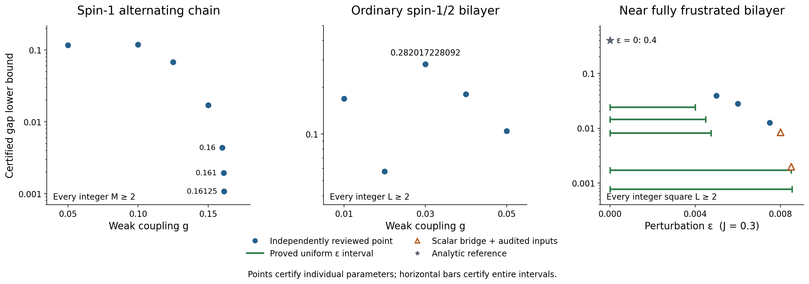
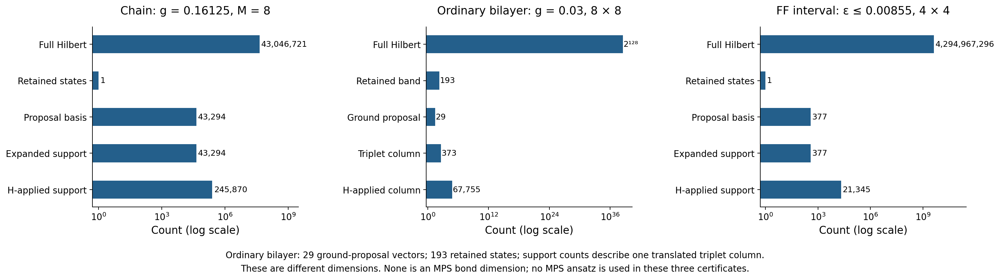

# Certified coupling and trial-space overview

Snapshot: **10 October 2026, 14:12 EDT / 18:12 UTC**. Static figures and exact data for the three active model families. This folder summarizes existing reviewed evidence; its extraction and plotting scripts do not run a new spectral audit or eigensolver.



[Vector PDF](certified_bounds.pdf) · [Exact bounds CSV](certified_bounds.csv) · [Complete JSON with source hashes](overview_data.json)

## What is certified

Strong bonds of the alternating spin-1 chain and rungs of both spin-1/2 bilayers have coupling **1**. Boundaries are periodic, retaining the specified positive-direction adjacency multiplicities at size two. Chain statements cover **every integer two-spin cell count M ≥ 2**; bilayer statements cover **every integer square side L ≥ 2**. Each certificate includes a unique finite-volume ground state.

Displayed numbers are rounded **down** to 12 decimal places. Full exact fractions are in the CSV/JSON. The gaps are sufficient lower bounds, not physical-gap estimates. The main chart shows the strongest reviewed point in this selected dataset at each coupling; older certified variants remain in the data. Each isolated point stands alone; no intervening parameter interval or physical phase boundary is inferred. Models and vertical plot scales are separate.

| Chain weak g | Gap lower bound |
|---:|---:|
| 0.05 | 0.116303868802 |
| 0.10 | 0.118954972866 |
| 0.125 | 0.068202652189 |
| 0.15 | 0.017013326349 |
| 0.16 | 0.004358246531 |
| 0.161 | 0.001952374069 |
| 0.16125 | 0.001075806295 |

Sources: [baseline audit](../../audit/independent/certificate_s1_W1_g1d20_k0_audit.json), [chain proof](../chain_audit/CHAIN_CERTIFICATE_PROOF.md), [independent frontier proof](../chain_frontier_review/FRONTIER_PROOF.md).

| Ordinary bilayer in-layer g, no crossed exchanges | Gap lower bound |
|---:|---:|
| 0.01 | 0.168921021674 |
| 0.02 | 0.057308457817 |
| 0.03 | 0.282017228092 |
| 0.04 | 0.180632156388 |
| 0.05 | 0.104475599844 |

Sources: [optimized baseline audit](../bilayer_audit/PROOF.md), [sealed large-seed review](../large_seed_review/REVIEW.md), [sector-Temple improvement](../temple_variant_review/REVIEW.md), [strongest exact acceptance record](../temple_variant_review/REVIEW_STATUS.json). The new g = 0.03/0.04/0.05 values use independently reviewed 4×4, 8×4, and 8×8 physical patches plus all-integer-size bridges. The independently reviewed sector-Temple improvement reuses those physical moments and complete band counts. Angle-based bounds **0.281837226184 / 0.179380190534 / 0.093620600631** remain in CSV/JSON. Their rigorous bounds need not decrease relative to older smaller-seed methods.

Two earlier g = 0.03 certificates remain in the data: **0.009195338283** from the [frozen small-seed review](../low_band_review/README.md), and **0.011205710127059** from its now [independently audited eight-round continuation and all-size bridge](../root_review/large_seed_bridges/PROOF.md). Neither is pending; both are superseded in the main chart.

For the near-fully-frustrated (FF) bilayer, **J = 0.3**, straight exchanges are **J + ε**, and crossed exchanges are **J**.

| Individual ε | Gap lower bound | Evidence level |
|---:|---:|---|
| 0.005 | 0.038983227177 | Independent review |
| 0.006 | 0.028171615330 | Independent review |
| 0.0075 | 0.012626894873 | Independent review |
| 0.008 | 0.008498663753 | Root scalar size bridge on audited physical inputs |
| 0.0085 | 0.001984903734 | Root scalar size bridge on audited physical inputs |

Sources: [FF point certificates](../nonperturbative_audit/EPSILON_FRONTIER.md), [later root size bridge](../root_review/FF_FRONTIER_BRIDGE.md). Orange triangles preserve the latter evidence distinction. At ε = 0, the separate [analytic reference theorem](../../two_d_theory/NONPERTURBATIVE_MODELS.md) gives the plotted uniform bound 2/5, even for all periodic rectangles nx, ny ≥ 2. The actual square gap for L ≥ 3 is 1; that stronger size-restricted value is not plotted.

The horizontal green segments are **genuine independently reviewed uniform interval theorems**:

| Entire ε interval | Uniform gap lower bound |
|---|---:|
| [0, 0.004] | 0.024046763298 |
| [0, 0.0045] | 0.014475263367 |
| [0, 0.00475] | 0.008090283176 |
| [0, 0.0085] | 0.001703099464 |
| [0, 0.00855] | 0.000768515509 |

The first three use one product trial: [original interval review](../nonperturbative_audit/INTERVAL_INDEPENDENT_REVIEW.md). The extensions combine seven exactly adjacent closed pieces, using fixed rational Ritz vectors for the six new pieces: [continuous-extension independent review](../epsilon_interval_review/INDEPENDENT_REVIEW.md). The widest interval is **not** a one-product-trial theorem. Segment length denotes its proved continuum interval.

## Trial-space accounting



[Vector PDF](trial_space_counts.pdf) · [43 seed-level dimension records](trial_dimensions.csv)

- Full Hilbert dimension counts every physical state: 9^M for the chain and 4^(nx ny) for a bilayer patch.
- Retained low-band count is the number of states whose enclosures enter the heat trace. The largest new ordinary-bilayer patch has **64 rungs, 128 physical spins, full dimension 2^128 = 340282366920938463463374607431768211456**, and a **193 = 1 + 3×64** state retained band.
- Its compressed ground proposal has **29 vectors**. Each localized translated triplet column has **373 configurations**, reaching **67,755** under H; 64 translations and exact spin multiplicity three produce the 192 excited directions. These per-column support counts are separate from the ground basis and complete retained band. Distinct CSV/JSON fields preserve these meanings.
- The FF interval's largest patch has 32 physical spins, full dimension 4,294,967,296, and uses one retained vector from a **377-coordinate** proposal on each extension piece. The displayed final-piece vector has full-action support **21,345**. The old one-product construction through ε = 0.00475 remains separately recorded.
- Coordinate-proposal rows use the selected coordinate-basis size as their expanded support capacity, not a count of nonzero coefficients. Unrecorded counts are null, never zero.
- The chain's largest accepted M = 8 proposal grows from **453** coordinates at g = 0.10 to **5,205** at g = 0.125 and **43,294** at the sampled g = 0.15, 0.16, 0.161, and 0.16125. One vector is retained. These are successful tested constructions, not lower bounds on all possible ansätze.
- None of these dimensions is an MPS bond dimension. The project's separate uniform spin-1-chain D = 26 route is not one of these three models and is not inserted into these counts.

A small residual alone does not certify a complete band or exclude missing low states; the linked audits supply full-Hilbert counting and spectral-tail arguments.

## Pending results and failures remain separate

[Unplotted status CSV](unplotted_status.csv) separates:

- Independently reviewed **recipe obstructions** at chain g = 0.1615, 0.1625, and 0.175. They exclude the stated ground-only/dimer-bin-tail/G-recursion family for all β and allowed local comparison parameters, not physical gapped phases or every possible method.
- FF failed finite grids at ε = 0.009, 0.01, 0.0125, 0.015, 0.02. A failed grid is not an all-temperature theorem.
The eight-round scalar continuation, larger angle-based certificates, and rank-one sector-Temple improvement are all independently accepted in this snapshot. The general multi-state inverse-moment implementation remains outside this numerical audit; no unreviewed numerical values are plotted.

No failure is encoded or plotted as a zero physical gap. No optimal coupling or infinite-volume uniqueness claim is added.

## Reproduce and verify

Python 3.12 and Matplotlib 3.10.8 were used. From the repository root:

```sh
python research_20261010/overview/plot_overview.py --check-only
python research_20261010/overview/plot_overview.py
```

The plotter verifies all 54 source SHA-256 hashes and every exact primary-gap JSON pointer before rendering. It pins itself to one allowed CPU, sets single-thread BLAS variables, and caps address space at 1 GiB. It writes only the PNG/PDF files and `validation.json` in this folder, plus a temporary plotting cache. It does not recompute the mathematical proofs.

To re-extract this explicitly selected claim set after reviewing source changes:

```sh
python research_20261010/overview/build_overview.py
python research_20261010/overview/plot_overview.py
```

`build_overview.py` and `extend_overview.py` are transparent selectors, not automatic claim-promotion rules. Review their statuses and this README before refreshing a later snapshot. `requirements-plot.txt` records the plotting dependency. `review_acceptance_snapshot.json` records the independently checked large-seed and Temple manifests at acceptance. `SHA256SUMS.json` fingerprints the deliverables; `VISUAL_QA.md` records rendered-image inspection.

The supplied tree has no `.git` metadata. Project source commit `6be889a30f642bde77fb89af75b3a7379615bed1` is reported context, not a locally verified checkout identity. No GitHub write was performed.
