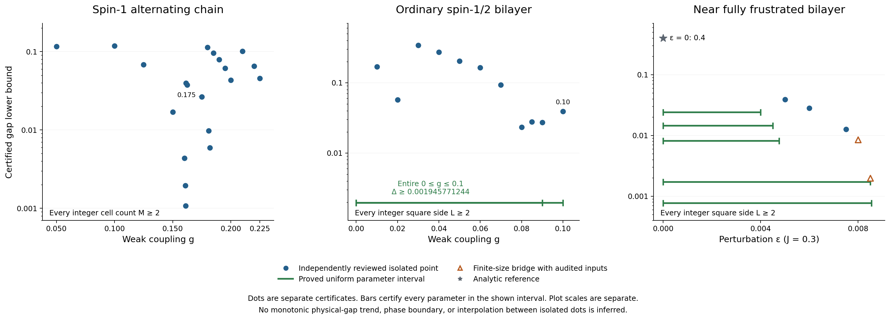
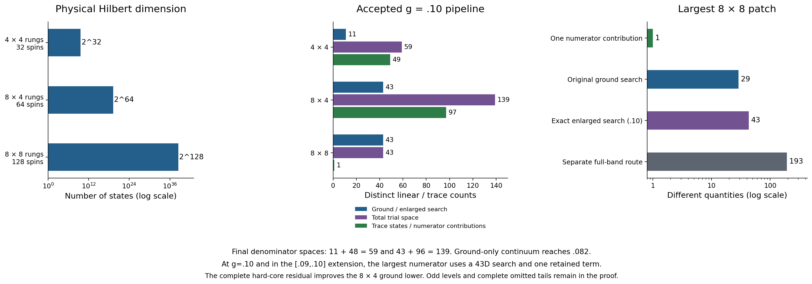

# Stage10 certified results and dimension accounting

Updated 2026-10-10 18:00 EDT (UTC−4) / 22:00 UTC. The exact extraction timestamp is recorded in overview_data.json.

This immutable snapshot extends [stage9](../overview_stage9/README.md), preserving its files and retaining **all 212 prior positive certificate rows** and their alternatives. New accepted claims use only pinned results with independently sealed PASS reviews. Source verification and figure extraction do not constitute a new audit of the spectral proof.

## Strongest accepted results

- **Ordinary square bilayer, every real 0≤g≤0.10, every integer L≥2: gap ≥0.001945771244.** The exact cover has 66 adjacent closed pieces. The isolated g=0.10 certificate gives the stronger bound **0.038976038275**. All earlier g=.09 alternatives are retained.
- **Alternating spin-1 chain, isolated g=0.225, every integer M≥2: gap ≥0.045509923956.** These isolated results do not certify a continuous chain interval.
- **Separate AKLT projector reference, periodic L≥5: gap ≥1/10**, with one D=2 MPS ground state. This result follows from a finite-size projector proof, not a successful thermal bootstrap.
- Uniform-Heisenberg D26 and synchronous mixed-cube results below are **recipe obstructions, not gap bounds or physical-purity upper bounds**. These results do not establish a minimum seed across all methods.

[Vector PDF](certified_bounds.pdf) · [All 225 exact positive certificate rows](certified_bounds.csv) · [Full provenance/data](overview_data.json) · [All prior method alternatives and history](../overview_stage7/README.md)

## Model and scope conventions

The alternating spin-1 chain contains M two-spin cells, with strong exchange one and weak exchange g. The ordinary spin-1/2 square bilayer has rung exchange one and straight intralayer exchange g in both layers and directions, without crossed exchange. The separate near-fully-frustrated bilayer has J=0.3, straight exchange J+ε and crossed exchange J. The uniform spin-one Heisenberg chain considered below has unit exchange on every microscopic bond. See [Hamiltonians and normalization](../MODELS_AND_NORMALIZATION.md).

The thermal certificate families use periodic boundaries and retain positive-direction periodic multiedges at size two. Chain results cover integer M≥2, and bilayer results cover integer square sides L≥2. Positive bounds certify a unique finite-volume ground state. They do not establish infinite-volume uniqueness or cover arbitrary rectangles. Displayed gap decimals are rounded downward to 12 places, with exact fractions and JSON pointers retained. These are sufficient lower bounds, not estimates of physical gaps, optimal thresholds or phase boundaries. Isolated bounds need not vary monotonically and do not justify interpolation.

## Historical third moment and g=0.09

The [independent third-moment review](../third_moment_review/REVIEW.md) verifies full original-trial H³ information, base moment M5, exact enlarged G/A matrices, Gram ranks, and both all-integer scalar certificates. At g=0.09, the enlarged search gives **0.027330086079**, while a separate two-vector numerator gives **0.001111944974**. Both remain in the data.

| Rung patch | Spins | Full Hilbert dimension | Checked enlarged rank | Search used by accepted pipeline | Total used trial dimension | Retained trace/numerator terms |
|---|---:|---:|---:|---:|---:|---:|
| 4×4 | 32 | 2^32 | 16 | 11 ground | 59 = 11+48 | 49 denominator states |
| 8×4 | 64 | 2^64 | 43 | 29 ground | 125 = 29+96 | 97 denominator states |
| 8×8 | 128 | 2^128 | 43 | 43 enlarged | 43 | 1 numerator contribution |

The enlarged 16/43 searches on the smaller patches were checked but were not used in the denominator certificates. Their complete omitted-state bounds remain inherited and unchanged. The largest new exact search has dimension 43, which differs from both the earlier ≤30 filtered span and a one-state numerator trace. These counts imply no new filtered-state residual, base M6, denominator lower bound, full many-body diagonalization or MPS bond dimension.

[Historical exact dimension records](trial_dimensions.csv). The current .10 dimension figure and counts appear below.

| Isolated bilayer g | Strongest accepted gap |
|---:|---:|
| 0.01 | 0.168921021674 |
| 0.02 | 0.057308457817 |
| 0.03 | 0.341601445704 |
| 0.04 | 0.272402896810 |
| 0.05 | 0.203655275044 |
| 0.06 | 0.164746706191 |
| 0.07 | 0.093479385120 |
| 0.08 | 0.023243965748 |
| 0.085 | 0.027887084487 |
| 0.09 | 0.027330086079 |

## Historical continuous interval through g=.09

The independently sealed [new interval review](../interval_range_009_review/REVIEW.md) adds seven exact adjacent closed pieces on **[0.085,0.09]**, with uniform lower bound **0.005788366954**. Combining these with all 49 earlier pieces preserves the bound **0.001945771244** throughout **[0,0.09]**. Each piece uses checked denominator residual/complete-tail inputs and finite-window/short-size certification, rather than interpolation between isolated points. The fixed largest numerator is selected in an exact search of dimension 43. The smaller denominator totals are 59/125, retaining 49/97 states.

| Exact lower g | Exact upper g | Uniform gap lower bound |
|---:|---:|---:|
| 17/200 | 43/500 | 0.024024513414 |
| 43/500 | 87/1000 | 0.014301717985 |
| 87/1000 | 11/125 | 0.005788366954 |
| 11/125 | 177/2000 | 0.020470914121 |
| 177/2000 | 89/1000 | 0.014672573603 |
| 89/1000 | 179/2000 | 0.012353003785 |
| 179/2000 | 9/100 | 0.006892292777 |

The original [0,0.07] cover contains 16 pieces. The extensions add 15 on [0.07,0.078], two on [0.078,0.08], seven on [0.08,0.082] and nine on [0.082,0.085]. Ground-only denominator coverage reaches g=0.082. Beyond that point, complete odd bands on the smaller patches supply 49/97 trace states. No odd band on the largest patch enters this interval construction. The earlier [0,0.085] proof uses no new H³ input. The .09 inputs belong to a separate extension.

[Vector PDF](ordinary_interval_pieces.pdf) · [All exact pieces](ordinary_interval_pieces.csv)

## Fixed D26 recipe for the uniform spin-one Heisenberg chain

The [sealed independent review](../uniform_seed_size_review/REVIEW.md) accepts the [diagnostics](../uniform_seed_size_diagnostics/README.md) at denominator microscopic lengths n=6,8,10,12. The numerator consists of exactly one Rayleigh contribution from the archived D26 MPS at length 2n. These recipe obstructions hold for any valid upper denominator traces, including exact traces.

| Denominator n | Full dimension 3^n | Numerator full dimension 3^(2n) | Strict recipe J_lower upper cap | Accepted obstruction |
|---:|---:|---:|---:|---|
| 6 | 729 | 531441 | 29/50 | All legal completed time-first delays then specified canonical conversion |
| 8 | 6561 | 43046721 | 71/100 | Same specified delayed-conversion family |
| 10 | 59049 | 3486784401 | 3/25 | First G update with four orthogonal denominator witnesses |
| 12 | 531441 | 282429536481 | 19/100 | First G update with four orthogonal denominator witnesses |

The bounds hold for all beta≥0. Only delay 0 is legal at n6, while delays 0 and 1 are legal at n8. Every converted cycle fails. A two-witness construction already gives J_lower<3/10 at n10/12. These are upper envelopes on attainable **certified lower inputs**, not upper bounds on the true physical purity. D=26, one numerator contribution, four denominator witnesses and the physical dimensions describe different objects. The result does not exclude richer numerators, other MPS, arbitrary adaptive switching, new later-base information or other inequalities. Untested n2/n4 and minima across all methods remain outside its scope.

[Vector PDF](recipe_upper_caps.pdf) · [Typed exact upper-envelope rows](recipe_upper_envelopes.csv)

### Excited-MPS witnesses

The [sealed core three-state review](../mps_excited_seed_review/REVIEW.md) independently verifies exact staggered source contractions and excludes the fixed one-Rayleigh D26 recipe for every beta≥0 at denominator lengths **n=14,16,20**. At **n=24**, the unresolved closed-box union is **[13/2,45/4] = [6.5,11.25]**. The specified recipe is excluded outside this union. An optimistic upper orbit that survives inside the window establishes neither realizable denominator bounds, a valid startup nor a physical gap. The three denominator witnesses have Sz=0,+1,−1 and are orthogonal fixed trials, not certified eigenvectors or a certified triplet. The ground MPS bond dimension D=26 and single-source bond upper bound 52 are distinct from the count of three linear witnesses and the full Hilbert dimensions 3^n / 3^(2n). Exact physical tests through n6, source contractions through n24 and ground contractions through n48 are sealed. This historical three-state screen is preserved. The independently sealed extensions below tighten it. [Exact upper-envelope rows](excited_witness_upper_envelopes.csv).

## Small ordinary-bilayer seeds: synchronous mixed-cube obstruction

The [independent acceptance](../joint_small_seed_review/ACCEPTANCE.json) and [proof](../joint_small_seed_review/PROOF.md) cover isolated g=0.04 and 0.05 for seeds 2×2/4×2/4×4 and their coordinate-swapped mirror, for every finite beta≥0 including the unbounded cold ray. Within the defined algorithm, none of the six synchronous complete-cube routes reaches a positive repeated-cycle or 499/500 small-defect onset, even with positive partial outputs, compatible same-base maxima, oriented-square root/product closure and full-joint retention.

The review checks 644 records, 5,778 sealed quotient upper comparisons and 520 partial-support patterns. Its scope excludes fresh trace injections, asynchronous other-base updates, stronger simultaneous optimizers, new inequalities or geometries, and conclusions covering all methods, physical gaplessness or a phase boundary. It supplies no new positive gap row and does not contradict the larger-seed positive certificates at g=.04/.05. See [all scoped statuses](unplotted_status.csv). None is plotted as a zero gap.

## Preserved references and alternatives

The data retain all 207 counted/joint chain candidate paths, historical fixed-order obstructions, earlier ordinary-bilayer ground/filter/combined alternatives, continuous near-frustrated interval proofs and the AKLT projector reference. Their source files remain unchanged. The historical stage7 unreviewed-.09 status is explicitly marked as superseded and is not used as a current rejection. [Chain paths](chain_candidate_routes.csv) · [Combined comparisons](combined_route_comparison.csv) · [Selected failures](combined_selected_failures.csv).

The AKLT convention is H=ΣP₂ with coefficient one. Periodic uniqueness holds from L=3, and the stated gap holds from L=5. At L=2 there are four ground states. The convention B+B²/3+2I/3=2P₂ doubles the gap. Failure of the current thermal-transfer sufficiency test does not prove that all transfer methods are impossible.

## New independently reviewed chain frontier

The [independent expanded-reference review](../chain_frontier_above_02_review/README.md) certifies three isolated couplings, each for every integer M≥2 with a unique finite-volume ground state:

| g | Gap lower bound | Initial β | Asymptotic onset M |
|---:|---:|---:|---:|
| 0.21 | 0.101607534008 | 8.3 | 64 |
| 0.22 | 0.065580452251 | 8.55 | 128 |
| 0.225 | 0.045509923956 | 8.7 | 256 |

The [8,16] finite window limits all three uniform bounds. The independent review contains the 72 saved paths and 378 window checks. This overview extracts its three accepted summaries, without certifying any interval between the points.

| Quantity | M=4 denominator | M=8 numerator |
|---|---:|---:|
| Physical spin count | 8 | 16 |
| Full Hilbert dimension | 3^8 = 6,561 | 3^16 = 43,046,721 |
| Comparison reference | 67 = 1+12+54 | Unchanged input |
| Complement of that reference | 6,494 | Not inferred from 67 |
| Ground trial / numerator search | 1,099 | 2 |
| Trial support | See full ground action 1,107 | 43,294 |
| Retained numerator contribution | Not this quantity | 1 |

The M4 reference contains one vacuum, 12 one-triplet states and 54 two-triplet states. All 20 single quintets lie in its complement. The weak-action union of 786 and residual union of 719 count configurations rather than MPS bonds. The expanded reference of 67 does not enlarge the M8 search. The independently accepted g=.25 result is an all-temperature obstruction only for its specified saved recipe. It proves neither physical gaplessness nor a universal frontier.

## New excited-MPS longitudinal and momentum screens

The [longitudinal extension](../mps_excited_seed_review/longitudinal_extension/REVIEW.md) and [momentum/spin-completion extension](../mps_excited_seed_review/momentum_extension/REVIEW.md) each have an independent SEALED PASS. The four-state longitudinal screen excludes the specified fixed D26 one-Rayleigh recipe at all β≥0 for n=14,16,20. At n24, successive necessary screens leave:

| Orthogonal denominator trials | Unresolved closed β interval |
|---:|---:|
| 3 (historical core) | [13/2,45/4] |
| 4 (longitudinal) | [31/4,11] |
| 48 (momentum) | [533/64,679/64] |
| 70 (exact spin completion) | [539/64,339/32] = [8.421875,10.59375] |

The exactly zero global-raising norm and total Sz=0 prove that this finite n24 trial is a singlet. This argument neither assumes an H eigenstate nor asserts singlet structure at uncomputed lengths. Exact normalized lowering maps each of 23 positive-norm transverse momentum modes to its longitudinal partner, giving 1+3×23=70 orthogonal states. The individual physical MPS bond dimensions are ≤52, whereas 70 is the linear-span dimension. The denominator full Hilbert dimension is 3^24=282429536481. The n48 numerator has 3^48=79766443076872509863361 states and retains one fixed D26 Rayleigh contribution. No full physical expansion is performed above n6.

The specified recipe is excluded at every β outside the corresponding interval. Points inside remain unresolved by this necessary-condition screen. They establish no certified startup, realizable upper denominator traces, gap bound, physical-purity upper bound or minimum seed across all methods.

[Vector PDF](mps_recipe_windows.pdf). These diagnostic figures are separate from the accepted gap plot.

## New ordinary bilayer g=.10: complete residual and all-size gap

The [sealed independent complete-residual review](../bilayer_complete_residual_8x4_review/REVIEW.md) certifies **g=1/10, every integer L≥2, gap ≥0.038976038275**, with a unique finite-volume ground state. The earlier [g=.10 diagnostics](../bilayer_g010_diagnostics_review/REVIEW.md) remain historical evidence within their stated scope. Their conditional sensitivity cases alone never established a gap proof.

The decisive new input is the complete physical hard-core residual of a saved even-singlet 8×4 vector. For the shifted Hamiltonian H′=Q+(g/2)A, its exact variance is

2448428261480406422854939482523166872870525432155341756199656673 / 6889457917632865412998596125412817968594334183872573551656077845000,

approximately 0.0003553876503424027. The justified sector-Temple ground lower bound is approximately −0.2532914854282799. The complete counted tail and all 96 odd-level endpoints are preserved. A small residual or approximate ground energy alone does not establish the thermal certificate.

### Exact hard-core residual mechanism

Write the enlarged vector ψ=Bc_B+Lc_L+(R+M)c_U and T_int=dH′=dQ+hA. Its full image separates into mutually orthogonal triplet-number sectors q=0,2,4,6,8. Complete B rows of the exact first-Hamiltonian matrix determine the q0/q2 amplitudes. The higher sectors are the coherent sums

- q4: L(4d c_L+h c_B,pair)+R(h c_L+4d c_U)+h(D4R+CM)c_U
- q6: M(h c_L+6d c_U)+h(C†R+D6M)c_U
- q8 squared norm: h²[||CMc_U||²+⟨Mc_U,[C,C†]Mc_U⟩]

Each sum is assembled before squaring so that all interference terms are retained. Here C annihilates rung-triplet singlet pairs, h_i projects onto the empty (singlet) rung, and Ω_e is the unnormalized pair singlet. On identical edges, the hard-core commutator is [P_e,P_e†]=3h_i h_j−|Ω_e⟩⟨Ω_e|. An ordered wedge gives an empty-center hop minus an occupied-center singlet reconnection. Parallel periodic edges are aggregated first, with weights w_e² and w_e w_f and no extra factor two. Both negative contributions are essential. This is an exact hard-core identity, not a canonical-boson approximation.

Fixed-origin rescaling uses N/4 for the CM norm and N/6 for the q6 commutator expectation. The audit checks all 4,495 q4 and 169,911 q6 supports, including the nonzero q6 image at configurations where the M vector vanishes. The q8 creation norm is obtained without enumerating production q8 supports. The variance follows by summing the orthogonal sector norms, dividing by d²||ψ||² and subtracting the exact mean squared. The decomposition has 57 bookkeeping columns, but the search dimension remains 43.

The argument also requires ground-state identification. The global λ₂ bound and an even-singlet trial below it identify the unique ground state. That state and the 96 orthogonal odd trials exhaust the 97 levels allowed below the cutoff. Temple's bound is then applied in the even-singlet sector while retaining complete omitted-spectrum counting. Scalar replay checks the heat ratios, recurrences, short sizes L=2,…,7, windows [8,16], [16,32], [32,64], and all L≥64. No largest-seed residual is claimed.

| Rung patch | Spins | Full Hilbert dimension | Ground/numerator search | Total trial dimension | Retained trace terms |
|---|---:|---:|---:|---:|---:|
| 4×4 | 32 | 2^32 | 11 | 59 = 11+48 | 49 denominator states |
| 8×4 | 64 | 2^64 | 43 | 139 = 43+96 | 97 denominator states |
| 8×8 | 128 | 2^128 | 43 | 43 | 1 numerator contribution |

Search ranks, total linear trial dimensions, retained trace-state counts and physical Hilbert dimensions are different quantities. None is an MPS bond dimension. The numerator remains the accepted single-trial contribution from a 43D search.

[Vector PDF](trial_space_counts.pdf) · [Current exact counts](stage10_bilayer_dimensions.csv)

## New independently sealed interval: every real 0≤g≤.10

The [independent interval review](../interval_range_010_review/REVIEW.md) certifies ten adjacent closed pieces on **[.09,.10]**, with uniform gap **≥0.008761649092** for all integer L≥2. Joined to the 56 preserved earlier pieces, all **66 pieces on [0,.10]** have uniform gap **≥0.001945771244**. No interpolation between isolated points is used.

The interval argument combines the fixed-vector affine mean, quadratic full second moment and variance with parameter-dependent sector cutoffs, odd levels, complete tails, rational interval trace bounds and exhaustive integer-size bridges. The review independently checks 46 finite windows (36 required), 60 short-size rows, and 480 odd modes. The entire extension uses the dimension accounting given above. Fixed-vector coupling polynomials alone do not establish the interval.

[All exact interval pieces](ordinary_interval_pieces.csv) · [Full provenance/data](overview_data.json)

## Chain g=.25: accepted fixed-recipe obstruction, no positive gap

The [rank195 independent review](../chain_frontier_rank195_review/PROOF.md) accepts the exact expanded-reference physics and a **fixed early-window obstruction** at g=1/4. Even an exact physical M4 trace cannot make the specified recipe succeed when it uses initial time-first purification, canonical transport and the mandatory first [8,16] signed-transfer window, with one numerator Rayleigh term from any real or complex vector in the old sealed two-dimensional M8 span. The obstruction covers all β≥0 for this stated recipe.

The necessary improvement in the M8 Rayleigh value is **strictly greater than 0.000426143856861**. The exact rational threshold is retained in overview_data.json. The rounded value **0.000426143856862 is an approximation only**, not a safe strict lower bound. This improvement is necessary, not sufficient. Rank195 counts a comparison reference. It neither replaces the unchanged two-dimensional M8 search nor measures a physical Hilbert space or MPS bond dimension.

No g=.25 positive gap, physical gaplessness, universal method obstruction, or all-method minimum seed follows. Better states outside the old span, multiple numerator terms, other inequalities/orders/geometries, and independently supplied early bridges are outside this obstruction.

## Excluded ongoing branches

This immutable snapshot excludes the MPS π-current and new chain-numerator refinements, regardless of producer proposals. Neither branch supplies an accepted plotted gap or zero-gap row. Historical pending statuses are explicitly marked as superseded wherever a stage10 independent seal now applies.

## Verification and reproduction

Run `bash REPRODUCE.sh`. It verifies all source hashes and pinned review manifests, the exact gap and upper-envelope pointers, all 212 preserved stage9 rows, alternatives, dimensions, closed-cover adjacency, and the uniform minimum. It also runs corruption-rejection tests and rerenders all twelve PNG/PDF files byte-for-byte in a temporary directory. It does not repeat expensive physical proof audits. The manifest covers scripts, data, documents, figures and QA. Replay uses one CPU, a 1 GiB address-space cap and one BLAS/OpenMP thread. No root documents, GitHub state or previously sealed files were edited.
