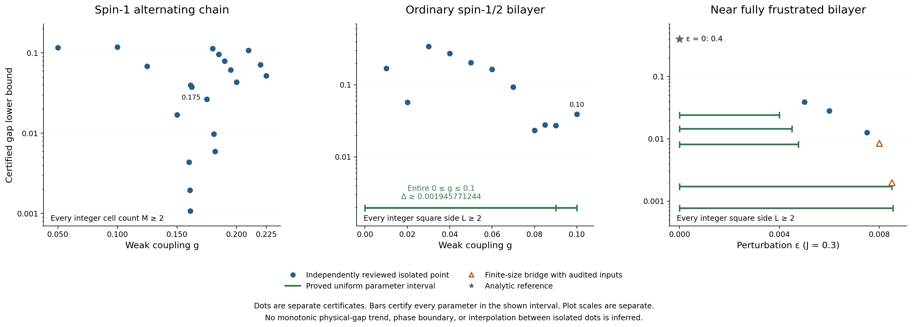
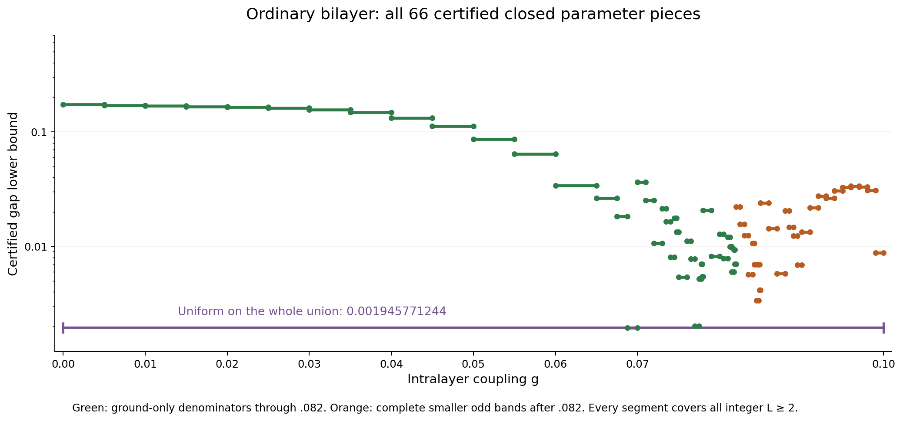
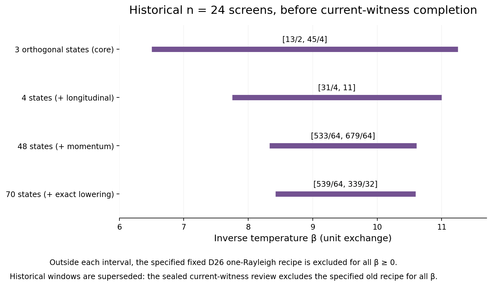
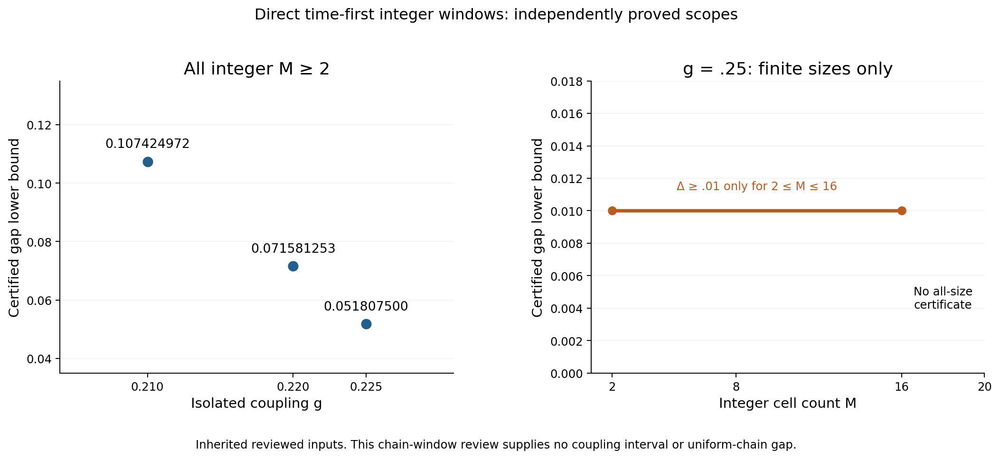
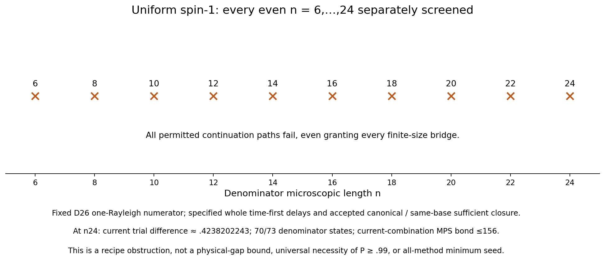
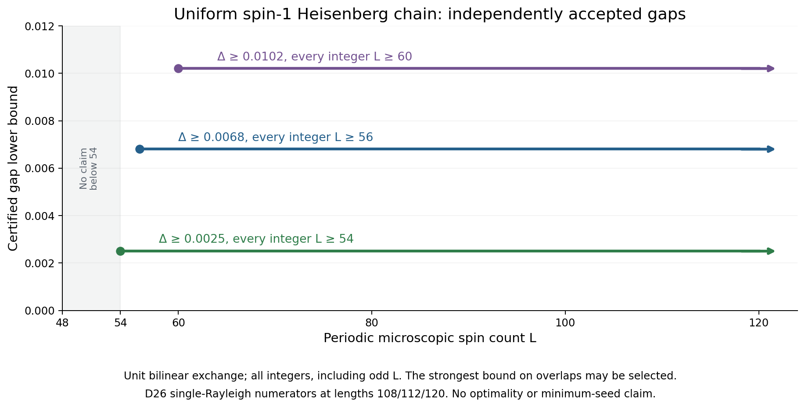

# Certified results and dimension accounting: stage11

Updated 2026-10-10 18:30 EDT (UTC−4) / 22:30 UTC. Exact extraction timestamp is recorded in overview_data.json.

This immutable snapshot extends [stage10](../overview_stage10/README.md), leaving its files unchanged and retaining **all 225 prior positive certificate rows** and their alternatives. Only pinned independently sealed PASS results enter new accepted claims. Source verification and figure extraction do not constitute a fresh spectral-proof audit.

## Strongest accepted results

- **Ordinary square bilayer, every real 0≤g≤0.10, every integer L≥2: gap ≥0.001945771244.** The exact cover has 66 adjacent closed pieces. The isolated g=0.10 certificate is stronger: **0.038976038275**. All previous g=.09 alternatives remain.
- **Alternating spin-1 chain, isolated g=0.225, every integer M≥2: gap ≥0.051807500.** No continuous chain interval is inferred.
- **Uniform spin-1 Heisenberg chain, unit exchange: gap ≥.0025 for every integer L≥54; ≥.0068 for L≥56; ≥.0102 for L≥60**, each with a unique finite-volume ground state. No claim below54 or minimum-seed theorem.
- **Separate AKLT projector reference, periodic L≥5: gap ≥1/10**, with one D=2 MPS ground state. It is a finite-size projector proof, not a thermal-bootstrap success.
- The fixed-small-seed D26 and synchronous mixed-cube exclusions below are **recipe obstructions, not gap bounds or physical-purity upper bounds**. No all-method minimum seed is known from these results.

[Vector PDF](certified_bounds.pdf) · [All 228 exact all-size positive certificate rows](certified_bounds.csv) · [Full provenance/data](overview_data.json) · [All prior method alternatives and history](../overview_stage7/README.md)

## Model and scope conventions

The alternating spin-1 chain has strong exchange one and weak exchange g, with M two-spin cells. The ordinary spin-1/2 square bilayer has rung exchange one and straight intralayer exchange g in both layers/directions, with no crossed exchange. The near-fully-frustrated bilayer is separate: J=0.3, straight J+ε and crossed J. The uniform spin-one Heisenberg chain below instead has unit exchange on every microscopic bond. See [Hamiltonians and normalization](../MODELS_AND_NORMALIZATION.md).

Thermal certificate families use periodic boundaries with positive-direction periodic multiedges retained at size two. Chain results cover integer M≥2; bilayer results cover integer square sides L≥2. Positive bounds certify a unique finite-volume ground state, not infinite-volume uniqueness or arbitrary rectangles. All displayed gap decimals are rounded downward to 12 places; exact fractions and JSON pointers are retained. Bounds are sufficient certificates, not estimated physical gaps, optimal thresholds or phase boundaries. Isolated points need not be monotone and imply no interpolation.

## Historical third moment and g=0.09

The [independent third-moment review](../third_moment_review/REVIEW.md) verifies full original-trial H³ information, base moment M5, exact enlarged G/A matrices, Gram ranks, and both all-integer scalar certificates. At g=0.09, the enlarged search gives **0.027330086079**, while a separate two-vector numerator gives **0.001111944974**. Both remain in the data.

| Rung patch | Spins | Full Hilbert dimension | Checked enlarged rank | Search used by accepted pipeline | Total used trial dimension | Retained trace/numerator terms |
|---|---:|---:|---:|---:|---:|---:|
| 4×4 | 32 | 2^32 | 16 | 11 ground | 59 = 11+48 | 49 denominator states |
| 8×4 | 64 | 2^64 | 43 | 29 ground | 125 = 29+96 | 97 denominator states |
| 8×8 | 128 | 2^128 | 43 | 43 enlarged | 43 | 1 numerator contribution |

The smaller enlarged 16/43 searches are checked but are not substituted into denominator certificates. Their complete omitted-state bounds remain inherited and unchanged. The largest new 43-dimensional exact search is distinct from the earlier ≤30 filtered span and from a one-state numerator trace. No new filtered-state residual, base M6, denominator lower bound, full many-body diagonalization, or MPS bond dimension follows from these counts.

[Historical exact dimension records](trial_dimensions.csv). The current .10 dimension figure and counts appear below.

| Isolated bilayer g | Strongest accepted gap |
|---:|---:|
| 0.01 | 0.168921021674 |
| 0.02 | 0.057308457817 |
| 0.03 | 0.341601445704 |
| 0.04 | 0.272402896810 |
| 0.05 | 0.203655275044 |
| 0.06 | 0.164746706191 |
| 0.07 | 0.093479385120 |
| 0.08 | 0.023243965748 |
| 0.085 | 0.027887084487 |
| 0.09 | 0.027330086079 |

## Historical continuous interval through g=.09

The independently sealed [new interval review](../interval_range_009_review/REVIEW.md) adds seven exact adjacent closed pieces on **[0.085,0.09]**, uniformly bounded below by **0.005788366954**. Together with all 49 earlier pieces, the whole **[0,0.09]** has the unchanged bound **0.001945771244**. Each piece uses checked denominator residual/complete-tail inputs and finite-window/short-size certification; it is not interpolation between isolated points. The fixed largest numerator is selected in exact dimension 43; smaller denominator totals are 59/125, retaining 49/97 states.

| Exact lower g | Exact upper g | Uniform gap lower bound |
|---:|---:|---:|
| 17/200 | 43/500 | 0.024024513414 |
| 43/500 | 87/1000 | 0.014301717985 |
| 87/1000 | 11/125 | 0.005788366954 |
| 11/125 | 177/2000 | 0.020470914121 |
| 177/2000 | 89/1000 | 0.014672573603 |
| 89/1000 | 179/2000 | 0.012353003785 |
| 179/2000 | 9/100 | 0.006892292777 |

The original [0,0.07] cover has 16 pieces; [0.07,0.078] adds 15; [0.078,0.08] adds two; [0.08,0.082] adds seven; [0.082,0.085] adds nine. Ground-only denominator coverage reaches g=0.082. After that, smaller complete odd bands supply 49/97 trace states. No largest-patch odd band enters this interval pipeline. The old [0,0.085] proof uses no new H³; new .09 inputs are a separate extension.

[Vector PDF](ordinary_interval_pieces.pdf) · [All exact pieces](ordinary_interval_pieces.csv)

## Uniform spin-one Heisenberg: fixed D26 recipe

The [sealed independent review](../uniform_seed_size_review/REVIEW.md) accepts the [diagnostics](../uniform_seed_size_diagnostics/README.md) at denominator microscopic lengths n=6,8,10,12. The numerator is exactly one Rayleigh contribution from the archived D26 MPS at length 2n. Any valid upper denominator traces, including exact traces, remain subject to these recipe obstructions.

| Denominator n | Full dimension 3^n | Numerator full dimension 3^(2n) | Strict recipe J_lower upper cap | Accepted obstruction |
|---:|---:|---:|---:|---|
| 6 | 729 | 531441 | 29/50 | All legal completed time-first delays then specified canonical conversion |
| 8 | 6561 | 43046721 | 71/100 | Same specified delayed-conversion family |
| 10 | 59049 | 3486784401 | 3/25 | First G update; four orthogonal denominator witnesses |
| 12 | 531441 | 282429536481 | 19/100 | First G update; four orthogonal denominator witnesses |

The bounds hold for all beta≥0. At n6, only delay 0 is legal; at n8, delays 0 and 1 are legal; each converted cycle fails. A two-witness construction already gives J_lower<3/10 at n10/12. These are upper envelopes on attainable **certified lower inputs**, not upper bounds on the true physical purity. D=26, one numerator contribution, four denominator witnesses, and physical dimensions count different things. No exclusion of richer numerators, other MPS, arbitrary adaptive switching, new later-base information or other inequalities is implied. Untested n2/n4 and all-method seed minima are outside scope.

[Vector PDF](recipe_upper_caps.pdf) · [Typed exact upper-envelope rows](recipe_upper_envelopes.csv)

### Excited-MPS witnesses

The [sealed core three-state review](../mps_excited_seed_review/REVIEW.md) independently verifies exact staggered source contractions and excludes the fixed one-Rayleigh D26 recipe for every beta≥0 at denominator lengths **n=14,16,20**. At **n=24**, the unresolved closed-box union is **[13/2,45/4] = [6.5,11.25]**; outside it the specified recipe is excluded. An optimistic upper orbit surviving inside the window does not certify realizable denominator bounds, actual startup or a physical gap. The three denominator witnesses have Sz=0,+1,−1 and are orthogonal fixed trials, not certified eigenvectors or a certified triplet. Ground MPS bond D=26 and single-source bond upper bound 52 are distinct from three linear witnesses and full Hilbert dimensions 3^n / 3^(2n). Exact physical tests through n6, source contractions through n24 and ground contractions through n48 are sealed. This historical three-state screen is retained; the independently sealed extensions below tighten it. [Exact upper-envelope rows](excited_witness_upper_envelopes.csv).

## Small ordinary-bilayer seeds: synchronous mixed-cube obstruction

The [independent acceptance](../joint_small_seed_review/ACCEPTANCE.json) and [proof](../joint_small_seed_review/PROOF.md) cover isolated g=0.04 and 0.05 for seeds 2×2/4×2/4×4 and their coordinate-swapped mirror, for every finite beta≥0 including the unbounded cold ray. All six synchronous complete-cube routes, positive partial outputs, compatible same-base maxima, oriented-square root/product closure, and full-joint retention have no positive repeated-cycle or 499/500 small-defect onset within the defined algorithm.

The review checks 644 records, 5,778 sealed quotient upper comparisons and 520 partial-support patterns. This does not cover fresh trace injections, asynchronous other-base updates, stronger simultaneous optimizers, new inequalities or geometries, all methods, physical gaplessness or a phase boundary. It supplies no new positive gap row. The larger-seed g=.04/.05 positive certificates coexist without contradiction. See [all scoped statuses](unplotted_status.csv); none is plotted as a zero gap.

## Preserved references and alternatives

All 207 counted/joint chain candidate paths, historical fixed-order obstructions, earlier ordinary-bilayer ground/filter/combined alternatives, continuous near-frustrated interval proofs, and the AKLT projector reference remain unchanged in source and retained in the data. The historical stage7 unreviewed-.09 status is annotated as superseded, not silently used as a current rejection. [Chain paths](chain_candidate_routes.csv) · [Combined comparisons](combined_route_comparison.csv) · [Selected failures](combined_selected_failures.csv).

AKLT means H=ΣP₂ with coefficient one. Its periodic uniqueness starts at L=3, the stated gap at L=5; L=2 has four ground states. The convention B+B²/3+2I/3=2P₂ doubles the gap. The current thermal-transfer sufficiency failure is not universal transfer impossibility.

## Historical expanded-reference chain frontier

The [independent expanded-reference review](../chain_frontier_above_02_review/README.md) certifies three isolated couplings, each for every integer M≥2 with a unique finite-volume ground state:

| g | Gap lower bound | Initial β | Asymptotic onset M |
|---:|---:|---:|---:|
| 0.21 | 0.101607534008 | 8.3 | 64 |
| 0.22 | 0.065580452251 | 8.55 | 128 |
| 0.225 | 0.045509923956 | 8.7 | 256 |

All three uniform bounds are limited by the [8,16] finite window. The 72 saved paths and 378 window checks belong to the independent review; this overview extracts its three accepted summaries. No interval between these points is certified.

| Quantity | M=4 denominator | M=8 numerator |
|---|---:|---:|
| Physical spin count | 8 | 16 |
| Full Hilbert dimension | 3^8 = 6,561 | 3^16 = 43,046,721 |
| Comparison reference | 67 = 1+12+54 | Unchanged input |
| Complement of that reference | 6,494 | Not inferred from 67 |
| Ground trial / numerator search | 1,099 | 2 |
| Trial support | See full ground action 1,107 | 43,294 |
| Retained numerator contribution | Not this quantity | 1 |

The M4 reference counts one vacuum, 12 one-triplet states and 54 two-triplet states; all 20 single quintets lie in its complement. Weak-action union 786 and residual union 719 count configurations, not MPS bonds. The expanded reference67 does not expand the M8 search. The independently accepted g=.25 result is only an all-temperature obstruction for its specified saved recipe, not physical gaplessness or a universal frontier.

## Historical excited-MPS longitudinal and momentum screens

Both the [longitudinal extension](../mps_excited_seed_review/longitudinal_extension/REVIEW.md) and [momentum/spin-completion extension](../mps_excited_seed_review/momentum_extension/REVIEW.md) are independently SEALED PASS. The four-state longitudinal screen excludes the specified fixed D26 one-Rayleigh recipe at all β≥0 for n=14,16,20. At n24, successive necessary screens leave:

| Orthogonal denominator trials | Unresolved closed β interval |
|---:|---:|
| 3 (historical core) | [13/2,45/4] |
| 4 (longitudinal) | [31/4,11] |
| 48 (momentum) | [533/64,679/64] |
| 70 (exact spin completion) | [539/64,339/32] = [8.421875,10.59375] |

The exact zero global-raising norm together with total Sz=0 proves this finite n24 trial is a singlet; it does not assume an H eigenstate or assert singlet structure at other uncomputed lengths. Exact normalized lowering turns each of 23 positive-norm transverse momentum modes into its longitudinal partner, giving 1+3×23=70 orthogonal states. Individual physical MPS bond dimensions are ≤52; 70 is a linear span dimension. The denominator full Hilbert dimension is 3^24=282429536481; the n48 numerator has 3^48=79766443076872509863361 states and retains one fixed D26 Rayleigh contribution. No full physical expansion is made above n6.

Every β outside the corresponding interval is excluded for the specified recipe. Inside is only an unresolved necessary-condition screen, never certified startup, realizable upper denominator traces, a gap bound, physical-purity upper bound, or an all-method minimum seed.

[Vector PDF](mps_recipe_windows.pdf). These diagnostic figures are separate from the accepted gap plot.

## New ordinary bilayer g=.10: complete residual and all-size gap

The [sealed independent complete-residual review](../bilayer_complete_residual_8x4_review/REVIEW.md) certifies **g=1/10, every integer L≥2, gap ≥0.038976038275**, with a unique finite-volume ground state. The earlier [g=.10 diagnostics](../bilayer_g010_diagnostics_review/REVIEW.md) remain historical, scoped evidence; their conditional sensitivity cases alone were never gap proofs.

The decisive update is a complete physical hard-core residual for a saved even-singlet 8×4 vector. With shifted H′=Q+(g/2)A, its exact variance is

2448428261480406422854939482523166872870525432155341756199656673 / 6889457917632865412998596125412817968594334183872573551656077845000,

approximately 0.0003553876503424027. Its justified sector-Temple ground lower is approximately −0.2532914854282799. The complete counted tail and all 96 odd-level endpoints are preserved; neither a small residual alone nor an approximate ground energy establishes the thermal certificate.

### Exact hard-core residual mechanism

Write the enlarged vector ψ=Bc_B+Lc_L+(R+M)c_U and T_int=dH′=dQ+hA. Its full image has mutually orthogonal q=0,2,4,6,8 triplet-number sectors. The q0/q2 amplitudes come from complete B rows of the exact first-Hamiltonian matrix. The higher sectors are coherent sums:

- q4: L(4d c_L+h c_B,pair)+R(h c_L+4d c_U)+h(D4R+CM)c_U
- q6: M(h c_L+6d c_U)+h(C†R+D6M)c_U
- q8 squared norm: h²[||CMc_U||²+⟨Mc_U,[C,C†]Mc_U⟩]

Each sum is assembled before squaring, retaining all interference. Here C annihilates rung-triplet singlet pairs, h_i projects onto the empty (singlet) rung, and Ω_e is the unnormalized pair singlet. The hard-core commutator uses [P_e,P_e†]=3h_i h_j−|Ω_e⟩⟨Ω_e| on identical edges; an ordered wedge gives an empty-center hop minus an occupied-center singlet reconnection. Parallel periodic edges are aggregated first; weights are w_e² and w_e w_f with no extra factor two. Both negative contributions are essential. This is an exact hard-core identity, not a canonical-boson approximation.

Fixed-origin rescaling uses N/4 for the CM norm and N/6 for the q6 commutator expectation. The audit checks all 4,495 q4 and 169,911 q6 supports, including nonzero q6 image where the M vector vanishes. The q8 creation norm is obtained without enumerating production q8 supports. Sum the orthogonal sector norms, divide by d²||ψ||², then subtract the exact mean squared. The decomposition's 57 bookkeeping columns do not expand the 43-dimensional search.

Ground identification is also required: the global λ₂ bound and an even-singlet trial below it identify the unique ground. That ground plus 96 orthogonal odd trials exhaust the 97 levels permitted below the cutoff. Temple is then applied in the even-singlet sector, with complete omitted-spectrum counting retained. Scalar replay checks the heat ratios, recurrences, short sizes L=2,…,7, windows [8,16], [16,32], [32,64], and all L≥64. No largest-seed residual is claimed.

| Rung patch | Spins | Full Hilbert dimension | Ground/numerator search | Total trial dimension | Retained trace terms |
|---|---:|---:|---:|---:|---:|
| 4×4 | 32 | 2^32 | 11 | 59 = 11+48 | 49 denominator states |
| 8×4 | 64 | 2^64 | 43 | 139 = 43+96 | 97 denominator states |
| 8×8 | 128 | 2^128 | 43 | 43 | 1 numerator contribution |

The search ranks, linear trial totals, retained trace states, and physical Hilbert dimensions are different quantities; none is an MPS bond dimension. The numerator is the unchanged accepted single trial contribution from a 43D search.

[Vector PDF](trial_space_counts.pdf) · [Current exact counts](stage10_bilayer_dimensions.csv)

## New independently sealed interval: every real 0≤g≤.10

The [independent interval review](../interval_range_010_review/REVIEW.md) certifies ten adjacent closed pieces on **[.09,.10]**, with uniform gap **≥0.008761649092** for all integer L≥2. Joined to the 56 preserved earlier pieces, all **66 pieces on [0,.10]** have uniform gap **≥0.001945771244**. No interpolation between isolated points is used.

The fixed-vector affine mean, quadratic full second moment and variance are combined with parameter-dependent sector cutoffs, odd levels, complete tails, rational interval trace bounds and exhaustive integer-size bridges. The review independently checks 46 finite windows (36 required), 60 short-size rows, and 480 odd modes. The entire extension uses the same dimension accounting above. Fixed-vector coupling polynomials alone would not establish this interval.

[All exact interval pieces](ordinary_interval_pieces.csv) · [Full provenance/data](overview_data.json)

## Chain g=.25: accepted fixed-recipe obstruction, no positive gap

The [rank195 independent review](../chain_frontier_rank195_review/PROOF.md) accepts the exact expanded-reference physics and a **fixed early-window obstruction** at g=1/4. Even an exact physical M4 trace cannot rescue the specified initial time-first purification, canonical transport, and mandatory first [8,16] signed-transfer window while the numerator is one Rayleigh term from any real or complex vector in the old sealed two-dimensional M8 span. The obstruction covers all β≥0 for this stated recipe.

The necessary improvement in the M8 Rayleigh value is **strictly greater than 0.000426143856861**; the exact rational threshold is retained in overview_data.json. The rounded value **0.000426143856862 is an approximation only**, not a safe strict lower bound. This improvement is necessary, not sufficient. Rank195 is a comparison reference count; it neither replaces the unchanged M8 two-dimensional search nor counts a physical Hilbert space or MPS bond.

No g=.25 positive gap, physical gaplessness, universal method obstruction, or all-method minimum seed follows. Better states outside the old span, multiple numerator terms, other inequalities/orders/geometries, and independently supplied early bridges are outside this obstruction.

## Stage11 extraction boundary

The seven new independent reviews below are included only at their pinned final seals, including the completed uniform cooled-seed review. Further pair/numerator refinements and new ordinary-bilayer direct-point/interval refinements are excluded from stage11. Unreviewed candidate scalar outputs are not promoted. Stage10 exclusions and older unresolved MPS windows remain labeled as historical and superseded where the stage11 reviews apply.

## Direct time-first windows: stronger all-size chain bounds

The [independent analytic and exact scalar review](../integer_window_refinement_review/PROOF.md) gives the following isolated-coupling certificates, with unique ground states. The physical inputs are inherited from independently reviewed, hash-matched records, not newly recomputed in this scalar review.

| g | Gap lower bound | Integer scope |
|---:|---:|---|
| .21 | .107424972 | Every M≥2 |
| .22 | .071581253 | Every M≥2 |
| .225 | .051807500 | Every M≥2 |
| .25 | .010000000 | Only 2≤M≤16 |

The first three add all-size rows while preserving every older alternative. The .25 result is in [a separate finite-size dataset](finite_size_certificates.csv); it never appears as an all-size point in the main gap figure. Failure of later continuation remains unresolved by this finite-window repair. No interpolation in g is certified.

The [producer prose erratum](../integer_window_refinement_review/PRODUCER_PROSE_ERRATUM.json) corrects “uniform purity exceeds .542” to “exceeds .54167130”: the exact lower endpoint is approximately .541671301. The numerical certificate itself was correct; the original producer proof and manifest remain unchanged. The accepted lemma does not relabel time and space or assume monotonicity of physical purity.

[Vector PDF](chain_window_refinement.pdf)

## New pair/block numerator inputs: symmetry correction matters

The [independent pair/block review](../chain_numerator_pair_block_review/PROOF.md) verifies full physical Gram/Hamiltonian forms and trial ranks 9,13,17 at g=.25. Rank17 supplies one reusable Rayleigh numerator for 16 spins in full dimension 3^16=43,046,721, with δ=ρ8−2ρ4 approximately .015304451528169765. This is a trial-energy shift, not a physical excitation gap or successful all-size bootstrap.

The five new bare directions span the complete translation-invariant singlet sector at weighted dimer energy E≤2: vacuum plus four pair-separation orbits. The added pair-derived directions and their full H images have exact S=0, translation +1 and physical reflection +1. Crucially, the inherited rounded ψ/u vectors are exactly Mz=0 only; they are not exact singlets or exact translation/reflection eigenvectors. Consequently, the combined 9D/13D/17D spans are not wholly exact symmetry sectors.

The [symmetry-scope erratum](../chain_numerator_pair_block_review/SYMMETRY_SCOPE_ERRATUM.md) is part of the accepted review. Arbitrary-vector Rayleigh, Gram-rank and full-span LDL arguments do not require those inherited numerator symmetries. No accepted M4 denominator, global-ground identification or M8 Rayleigh-numerator argument relied on the rounded M8 vectors being exact singlets. Exact whole-span exclusions concern only the old canonical-transport first [8,16] recipe; they do not exclude the separate direct time-first window route. No all-size positive gap or physical no-gap result is claimed.

## Uniform chain: transfer-moment trace improvement only

The [independent transfer-moment review](../uniform_transfer_moment_review/REVIEW.md) certifies Z24(21/2)≤1.238492320537 and Z48(21/2)≤1.131484383792, in the archived shifted normalization a=700741/500000. It checks all 56 even lengths 10,…,120 using inherited physical heat enclosures and self-adjoint thermal-history transfer identification.

The proof removes one spectral occurrence of x=λ² and applies residual moment positivity with integer spectral multiplicity; it does not assume finite thermal-transfer rank or identify that rank with physical dimension or MPS bond26. Directed arithmetic and a global polynomial-sign argument establish the support caps and upper traces.

All eight tested fixed cooling-only starts fail. These are bounded recipe tests, not all-temperature impossibility, physical gaplessness, or a theorem excluding smaller seeds or other MPS. No new uniform-chain gap follows. The separately completed cooled-seed proof below establishes positive gaps using additional physical contractions and analytic arguments; the moment review alone does not.

## Uniform chain: current witnesses and complete even-size recipe screening

The [current-witness independent review](../mps_commutator_review/REVIEW.md) matches all 74 exact integers from 37 n24 correlation pairs in a separately coded uncached contraction. It improves the π trial-energy difference from approximately .4910226054728026 to **.4238202243082572**. This is a Rayleigh trial difference, not a physical spectral gap. The compact commutator is w=[H,Aπ]ψ; ψ is not assumed to be an eigenstate, so replacing w by (H−⟨H⟩)Aπψ would be invalid.

| Quantity | Accepted meaning |
|---|---|
| 2 | Local π search dimension |
| 70 or 73 | Orthogonal denominator trial directions at n24 |
| 26 | Archived ground/numerator MPS bond dimension |
| ≤156 | Current-combination MPS bond bound |
| 1 | Retained length48 numerator Rayleigh contribution |
| 3^24 / 3^48 | Full denominator/numerator Hilbert dimensions |

Both 70- and 73-state constructions exclude the specified old whole-cycle time-first/canonical recipe for every β≥0. This supersedes the historical unresolved n24 windows plotted earlier. The independent [even-size completion](../mps_seed_even_completion_review/REVIEW.md) separately checks n18 and n22 using 3- and 4-state denominator alternatives and fixed D26 numerator lengths36/44; no monotonicity in seed size is assumed.

The separately sealed [relaxed-path review](../mps_direct_window_review/REVIEW.md) checks every even n=6,…,24 individually. It grants all finite-size bridges for free, and exhausts fixed G startup, any completed whole time-first delays, followed by either the inherited same-base sufficient closure P≥.99 or accepted joint-aware canonical continuation. Every permitted continuation path dies. At n24 the maximum optimistic P is bounded by approximately .674058153615001, and the largest positive physical base is96 with the correctly doubled temperature.

The .99 threshold belongs to that sufficient closure; it is not a universal necessary condition. The result does not exclude a different recurrence, stronger initialization/numerator, other closure, or arbitrary adaptive mid-cycle switching. It implies neither a physical-gap bound nor an all-method minimum seed.

[Vector PDF](accepted_recipe_scope.pdf)

## New uniform Heisenberg-chain gap certificates

The [independent cooled-seed review](../uniform_cooled_seed_review/REVIEW.md) certifies the periodic uniform spin-1 chain H=ΣS_j·S_{j+1}, with bilinear coefficient one:

| Gap lower bound | Valid integer lengths | Seed inverse temperature | Small-defect onset |
|---:|---|---:|---:|
| .0102 = 51/5000 | Every L≥60 | 105/4 | 960 |
| .0068 = 17/2500 | Every L≥56 | 609/25 | 1792 |
| .0025 = 1/400 | Every L≥54 | 2373/100 | 3456 |

Each scope includes odd as well as even lengths and a unique finite-volume ground state. The stronger applicable bound can be chosen where ranges overlap. These are stored in [a separate large-size certificate dataset](uniform_large_size_certificates.csv); they are not relabeled as L≥2 claims in the main inherited plot. There is no claim below54 and no proof of a smallest possible seed. A failed floating proposal at n52 is not an exclusion.

The review independently reconstructs the physical D26 tensors and Hamiltonian insertion, checks tiny physical amplitudes, and contracts lengths104/108/112/120 by sequential powers rather than the producer's binary-power method. The positive norms and exact shifted-Rayleigh inequalities are checked without assuming a ground state or uniqueness. The n54/n56/n60 certificates use one retained numerator term at lengths108/112/120; D=26 is an MPS bond, and its norm-transfer dimension676 is neither a physical Hilbert dimension nor the thermal-transfer rank. Physical denominator/numerator dimensions are 3^n / 3^(2n).

The proof inherits the nine independently audited β=21/2 heat inputs and the exact all-integer self-adjoint thermal-history transfer construction. It uses cooling of physical seam partition functions, sector multiplicity and mass bounds, a generalized sector-power lemma valid for real q≥1, complete finite windows, and a signed odd-integer bridge. The staggered quantities S(n,β), T(2n,β) advance to S(2n,2β), T(4n,2β); no fixed-temperature relabeling is made.

The n60 route improves the prior bound without reducing its physical seed. The n56 route uses the original quadratic-tail structure; n54 additionally uses generalized sector powers. These new physical-input and analytic changes coexist with the earlier fixed-recipe exclusions at n6…24 without contradiction. This is a scoped computational/analytic certificate with explicitly inherited heat premises, not a fresh recomputation of those heat traces or proof-assistant formalization.

[Vector PDF](uniform_gap_frontier.pdf) · [Exact large-size records](uniform_large_size_certificates.csv)

## Verification and reproduction

Run `bash REPRODUCE.sh`. For a repository checkout, it first runs [lossless exact-evidence hydration](../../reproducibility/stage11_exact_evidence/README.md) via `python3 ../../reproducibility/stage11_exact_evidence/materialize.py --repo-root ../..`. The content-addressed compressed transport restores the original evidence paths and exact bytes, validating hashes before placement; producer/review raw hashes and seals are unchanged. It then verifies all source hashes and pinned review manifests, the exact gap and upper-envelope pointers, all 225 preserved stage10 rows, alternatives, dimensions, closed-cover adjacency, and uniform minimum; it runs corruption rejection tests and rerenders all eighteen PNG/PDF files byte-for-byte in a temporary directory. It does not repeat expensive physical proof audits. The manifest covers scripts, data, documents, figures and QA. One CPU, 1 GiB address-space cap, BLAS/OpenMP one thread. No root documents, GitHub state or prior sealed files were edited.
