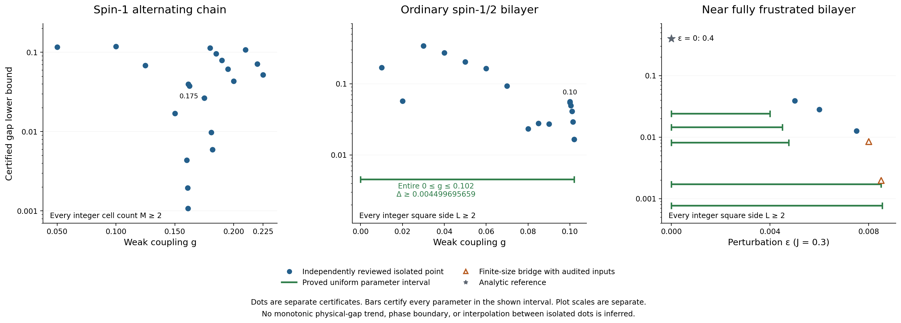
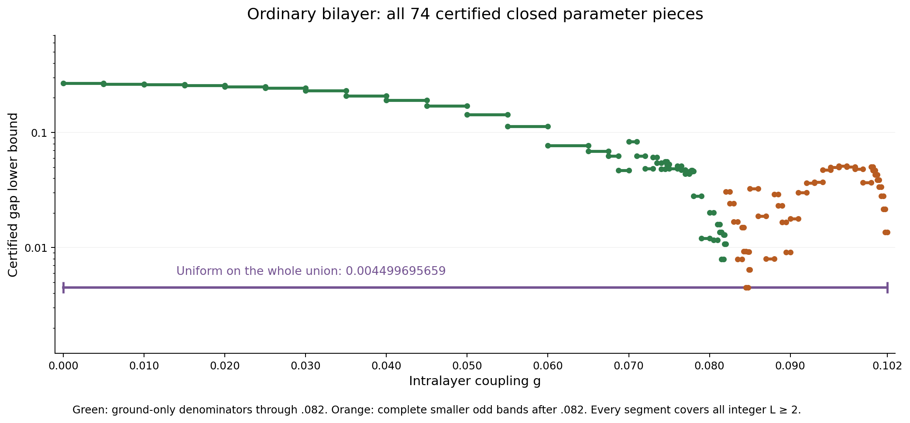
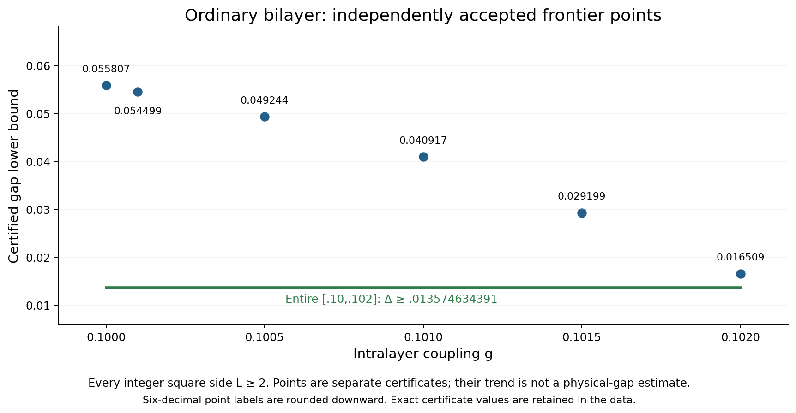
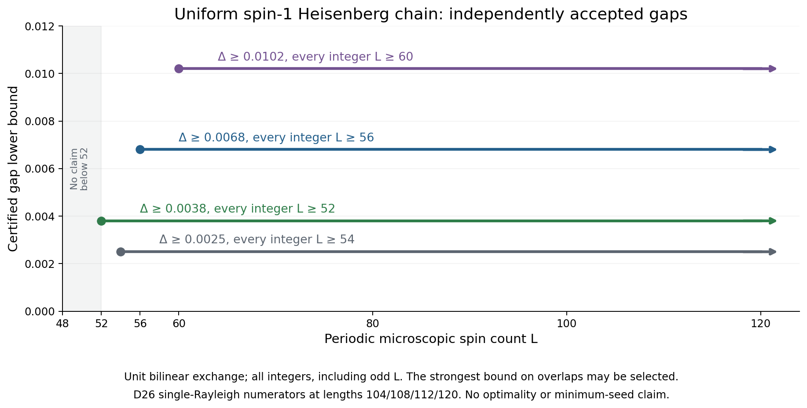
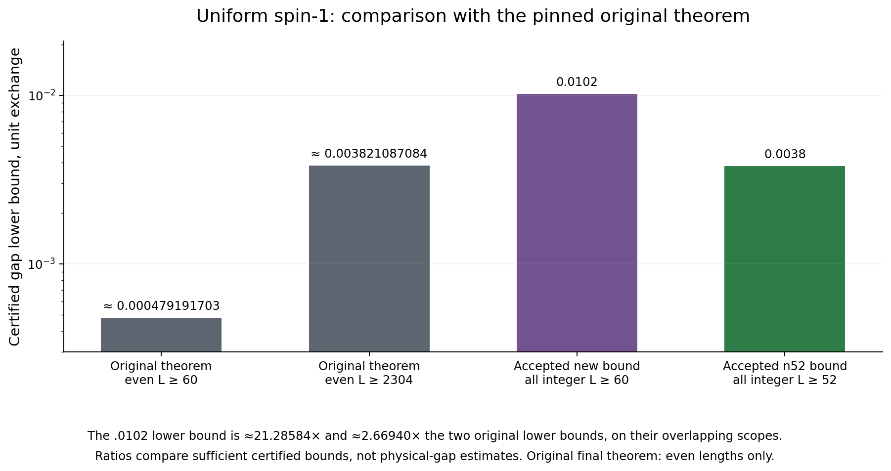

# Certified research overview: stage12

Updated 2026-10-10 18:45 EDT (America/New_York, UTC−4) / 22:45 UTC. The exact extraction and freeze times are recorded in overview_data.json and FROZEN_STATUS.json.

This immutable snapshot extends [stage11](../overview_stage11/README.md), preserving every one of its 228 M/L≥2 certificate records, its separate finite chain result, its three uniform large-size records, all 66 old bilayer pieces, and all prior alternatives. Only final independently sealed results enter accepted claims. Integrity/extraction checks are not a new physical-proof audit.

## Current accepted results

- Ordinary square bilayer, isolated g=.10: gap ≥.055807148827; isolated g=.102: gap ≥.016509932002 for every integer square side L≥2, with a unique finite-volume ground state.
- The entire bilayer interval 0≤g≤.102: gap ≥.004499695659 for every integer L≥2, with a unique finite-volume ground state. This is a complete closed cover, not interpolation between isolated points.
- Uniform spin-1 Heisenberg chain: gap ≥.0038 for every integer L≥52; ≥.0068 for L≥56; ≥.0102 for L≥60. Odd lengths are included and the ground state is unique in each scope. The older .0025 for L≥54 remains a valid, now weaker alternative.
- Alternating spin-1 chain, isolated g=.21/.22/.225: respective gaps ≥.107424972/.071581253/.051807500, every integer cell count M≥2. At g=.25, only M=2,…,16 has the separate gap ≥.01; no all-size .25 certificate is claimed.

[Vector PDF](certified_bounds.pdf) · [All M/L≥2 records and preserved alternatives](certified_bounds.csv) · [Full exact data/provenance](overview_data.json)

## Models and scope

The alternating chain has unit strong exchange and weak exchange g, with M two-spin cells. The uniform chain instead has H=ΣS_j·S_{j+1}, unit bilinear exchange on every microscopic bond and L spins. The ordinary spin-1/2 square bilayer has unit rung exchange and straight intralayer exchange g in both layers/directions, without crossed exchange. The near-fully-frustrated bilayer is a separate model with J=.3, straight J+ε and crossed J. See [model definitions and normalization](../MODELS_AND_NORMALIZATION.md).

Periodic positive-direction multiedges are retained at side/cell size two. A square all-L result is not a theorem for arbitrary rectangles. Finite-volume unique ground states do not establish infinite-volume uniqueness. Decimals marked as lower bounds are rounded downward; exact fractions and source JSON pointers are retained. Every bound is a sufficient certificate, not an estimate of the physical gap, an optimal threshold or a phase boundary. An isolated coupling implies no interpolation.

## New two-dimensional direct-window theorem

The [independent analytic and exact review](../bilayer_direct_window_review/PROOF.md) uses real self-adjoint Hilbert–Schmidt transfer operators in each spatial direction, including odd transverse circumferences. Transfer eigenvalues may have either sign; positivity of every physical partition function supplies the signed odd-integer step. Neither operator positivity nor a canonical-boson approximation is assumed.

For the correctly staggered time-first endpoints a≤T(n,m;β), b≤Sx(n,m;2β), c≤Sy(2n,m;2β), the direct rectangular-window bound is

I = a⁴(2b√c−1)√(2b²√(2c−1)−1).

The review checks all positive square-root gates and uses directed lower arithmetic. First varying the y direction and then x is essential; the endpoints cannot be relabeled as three purities at one geometry. At the next full cycle, both spatial bases and β double. Every early finite window, all short sides L=2,…,7, and the asymptotic closure are checked.

For g=.10, nine exact paths pass; the selected certificate starts at β=187/20 and enters the asymptotic theorem at side1024, β=11968/5. The physical inputs are inherited unchanged from the complete hard-core residual review. This point review alone does not improve a coupling interval.

The [producer erratum](../bilayer_direct_window_review/snapshot/PRODUCER_PROSE_ERRATUM.json) corrects the printed fraction to 55807148827/10^12=.055807148827 and its resource prose to 91,684 KiB (about89.54 MiB). The original certificate JSON and decimal were already correct; original producer bytes are preserved.

## Improved continuous cover on [0,.10]

The [independent continuation review](../bilayer_direct_window_continuation_review/PROOF.md) applies the accepted direct-window theorem to all 66 previously accepted physical interval records. It independently verifies 517 required finite windows, all short-size bridges, exact base/temperature labels and terminal exponential witnesses.

The resulting whole-interval bound is .004499695659; the limiting closed piece is [169/2000,339/4000]=[.0845,.08475]. The old .001945771244 proof remains in the data unchanged. The improvement uses a new certified continuation, not a physical-gap monotonicity assumption or pointwise interpolation.

[Current exact pieces](ordinary_interval_pieces.csv) · [Preserved stage11 pieces](historical_interval_pieces_stage11.csv) · [Vector PDF](ordinary_interval_pieces.pdf)

## New frontier through g=.102

The [independent point review](../bilayer_frontier_above_010_review/PROOF.md) accepts five additional isolated points, each for every integer square side L≥2 with a unique ground state:

| g | Certified gap lower bound |
|---:|---:|
| .1001 | .054499712024 |
| .1005 | .049244008353 |
| .1010 | .040917096762 |
| .1015 | .029199965244 |
| .1020 | .016509932002 |

The review independently re-evaluates the new-coupling sector cutoffs, ground identification, full odd-mode and complete spectral-tail bounds, exact thermal recurrences and short-size bridges. Its separate legal-domain calculation concerns validity of these physical hypotheses, not a gap throughout that larger domain.

The [frozen-point metadata erratum](../bilayer_frontier_above_010_review/snapshot/METADATA_ERRATUM.json) fixes the odd-band family label: the exact polynomials use fixed z=1/10, not the changing physical coupling or interval midpoint. The label correction changes no numerical certificate. The independently checked polynomial coefficients establish the actual fixed family.

The [separate final interval review](../bilayer_frontier_interval_0102_review/PROOF.md) accepts all eight adjacent closed pieces on [.10,.102], with uniform gap ≥.013574634391. It checks 68 finite windows as well as endpoint physical inputs and all short-size bridges. Together with the 66 improved direct-window pieces on [0,.10], the entire **[0,.102]** has **74 closed pieces** and uniform gap **≥.004499695659**. Both statements cover all integer square L≥2 and unique finite-volume ground states. This interval claim comes from the sealed interval proof, not the isolated point table.

[Vector PDF](bilayer_frontier.pdf) · [All 74 current exact pieces](ordinary_interval_pieces.csv)

### Dimension accounting and complete residual inheritance

| Rung patch | Spins | Full Hilbert space | Ground/numerator search | Total trial dimension | Retained trace terms |
|---|---:|---:|---:|---:|---:|
| 4×4 | 32 | 2^32 | 11 | 59 = 11+48 | 49 denominator states |
| 8×4 | 64 | 2^64 | 43 | 139 = 43+96 | 97 denominator states |
| 8×8 | 128 | 2^128 | 43 | 43 | 1 numerator term |

The [accepted complete residual](../bilayer_complete_residual_8x4_review/REVIEW.md) retains coherent q0/q2/q4/q6/q8 interference and the exact signed hard-core commutator, including occupied-center reconnection and same-edge negative terms. Sector ground identification is required before applying Temple. All odd-band endpoints and complete omitted-state tails remain present. No new largest-seed complete residual, many-body diagonalization, or MPS bond count is inferred from these dimensions.

[Current dimension records](stage10_bilayer_dimensions.csv) · [Historical dimension records](trial_dimensions.csv)

## Uniform chain: the n52 Hermite certificate

The [independent n52 review](../uniform_seed_frontier_review/REVIEW.md) proves gap≥19/5000=.0038 and a unique ground state for every integer L≥52. Its canonical seed is n52 at β=567/25, with T(104,567/25); the asymptotic onset is3328. A separately checked direct window104…208 is not mislabeled as the initial n52 seed.

The new input improvement is an exact Hermite majorant. For 0≤x≤h and rational interior t, Q interpolates x^k and its derivative at t and its value at h. An independently verified polynomial factorization gives Q(x)−x^k=(h−x)(x−t)²P(x), with nonnegative P on the whole closed support. Multiplication by x³ handles x=0 without division. Summing the bound uses the same third/fourth/fifth squared-spectrum moments; the negative coefficient takes the lower moment endpoint, independently checked against every box corner.

This is a new analytic/scalar consequence of the same nine β=21/2 thermal inputs and the previously reconstructed MPS104. It is not a fresh heat-trace computation or new MPS contraction. D26, the trial norm-transfer dimension676, one retained Rayleigh term, and full physical space3^104 are different quantities. No gap below52 or smallest-seed theorem is claimed.

[Exact large-size certificates](uniform_large_size_certificates.csv) · [Vector PDF](uniform_gap_frontier.pdf)

## Original source scope and theorem comparison

The [independently sealed source-scope review](../uniform_source_scope_review/README.md) checks pinned original source blobs. The original transfer proposition supports the untwisted physical identity for every integer n≥4, without staggering or an odd-length twist. The original final gap theorem itself is stated for even lengths. Our new odd-length claims use the accepted signed-integer interpolation; the transfer identity alone is not a gap proof. The source supplement deliberately uses n≥4 rather than the broader n≥2 wording in earlier local notes, and every new uniform-chain scope starts at52 or higher.

| Certificate | Certified lower bound | Length scope |
|---|---:|---|
| Original theorem | (4/105)log(80/79) ≈ .000479191703118 | Even L≥60 |
| Original theorem | log20/784 ≈ .003821087083615 | Even L≥2304 |
| Accepted cooled review | .0102 | Every integer L≥60 |
| Accepted n52 review | .0038 | Every integer L≥52 |

On their overlapping scopes, .0102 is approximately21.2858443367 and2.66939741932 times the two original certified lower bounds. These compare sufficient lower bounds, not improvements in an estimated physical gap. The archived .005908566393 for L≥1920 is a later reproduction, not the original theorem.

[Vector PDF](uniform_theorem_comparison.pdf) · [Exact enclosures and ratios](../uniform_source_scope_review/results.json) · [Source locations and blob IDs](../uniform_source_scope_review/SOURCES.json)

The unchanged upstream TeX snapshots retain the [Apache2.0 license and attribution companion](../uniform_source_license_supplement/README.md). Both supplements have independently pinned immutable manifests; no earlier review is rewritten.

## Preserved chain, MPS and reference results

All 228 prior M/L≥2 rows, the finite g=.25 record, three previous uniform large-size records, 207 historical chain routes, complete bilayer alternatives and diagnostics remain available. New rows never overwrite the earlier exact records.

- [Chain finite-window comparison](chain_window_refinement.png) and [finite-size certificate](finite_size_certificates.csv) keep the .25 M=2,…,16 result separate from all-size chain bounds.
- The [pair-block symmetry erratum](../chain_numerator_pair_block_review/SYMMETRY_SCOPE_ERRATUM.md) remains essential: only the added pair-derived directions/full images are exact singlets and symmetry eigenvectors. Inherited rounded numerator vectors do not need those symmetries; the combined9D/13D/17D spans are not whole exact symmetry sectors. Their old-route exclusions do not exclude the new direct-window theorem.
- The [current-witness review](../mps_commutator_review/REVIEW.md) matches all74 exact integers. The .4238202243082572 result is a trial-energy difference, not a physical excitation gap. The 70/73-state old-recipe exclusions and separately checked even n18/22 results are retained.
- The [relaxed-path screen](accepted_recipe_scope.png) separately excludes its specified fixed recipe at every even n6,…,24, even granting bridges. Its P≥.99 closure is sufficient, not universally necessary. It does not contradict new accepted proofs using larger seeds and improved inputs.
- [Historical MPS windows](mps_recipe_windows.png) remain explicitly superseded; they are not current startup claims. [Fixed recipe caps](recipe_upper_caps.png) are not physical-purity or gap upper bounds.
- [AKLT reference](aklt_reference_scope.png): separate H=ΣP₂ proof, gap≥1/10 for periodic L≥5, uniqueness fromL≥3. D=2 is an MPS bond; this is not a thermal-bootstrap success.

[Stage11 narrative and full historical details](../overview_stage11/README.md)

## Verification and reproduction

Run `bash REPRODUCE.sh` from this directory. It first [hydrates exact evidence](../../reproducibility/stage11_exact_evidence/README.md) with `python3 ../../reproducibility/stage11_exact_evidence/materialize.py --repo-root ../..`. Content-addressed compressed transport restores the original paths, hashes, bytes and modes; no raw producer/review seal changes.

The snapshot independently tests empty-root hydration against the final mapping, verifies every selected source/review seal and all prior stage11 files, checks exact JSON pointers, decimal directions, finite/large-size distinctions and complete interval adjacency, rejects deliberate corruptions, and rerenders all twenty-two PNG/PDF exports byte-for-byte in temporary directories. No root documents, previous sealed artifacts, or GitHub state are changed. CPU8, one numerical thread and a1GiB address-space cap apply. This is scoped extraction/presentation QA, not another expensive physical-proof audit.
