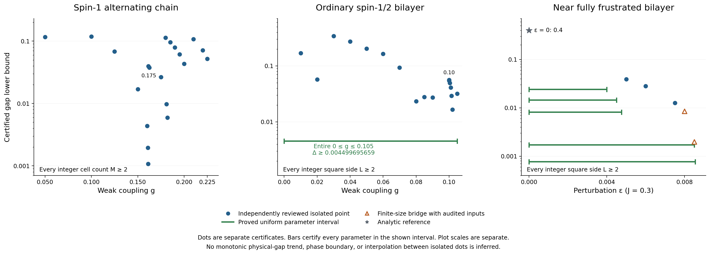
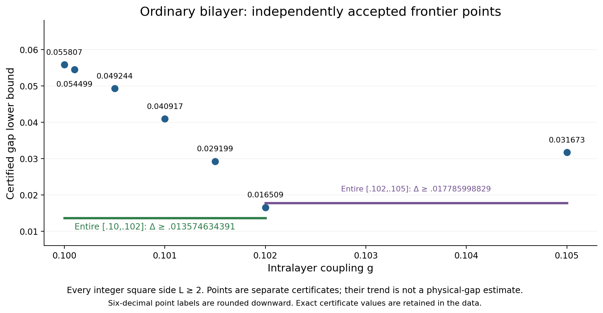
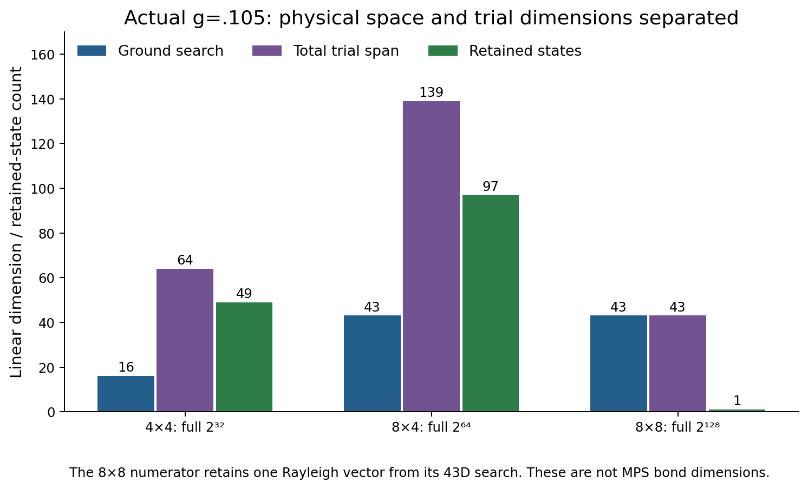
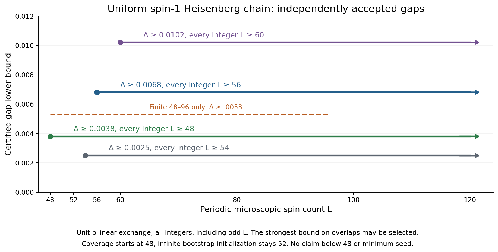

# Stage 13. Verified research overview

This immutable snapshot preserves every stage 12 result and adds only finalized independent reviews. Model normalization and periodic multiedge conventions remain those in [the model record](../MODELS_AND_NORMALIZATION.md). This overview checks provenance and scoped extraction. The linked independent reviews contain the physical and exact scalar proofs.

## New positive result. Ordinary spin-1/2 bilayer

- Every real g in **[0,.105]**, every integer periodic square side **L≥2** has a gap **≥.004499695659**, with a unique finite-volume ground state. The cover has **80 closed pieces**.
- Six new pieces covering **[.102,.105]** have uniform gap **≥.017785998829**. Their review checks 50 finite windows, 288 odd-mode interval checks and 12 physical endpoints, without assuming physical-gap monotonicity.
- At **g=.105 alone**, the stronger gap is **≥.031673112867**, every integer L≥2. Initial β=47/5, eight finite windows, terminal witness from L2048. No hypothetical error-budget target is assumed.
- The stage 12 74-piece cover and stage 11 66-piece cover remain separate historical records. All **311** prior main claim rows are unchanged. There are now **320**, plus the unchanged finite-chain record and four uniform large-size records. Two separate new uniform records describe the finite 48–96 window and its all-integer L≥48 coverage consequence.

See the following proofs and records. [actual point](../bilayer_g0105_actual_point_review/PROOF.md), [closed interval](../bilayer_interval_0102_0105_review/PROOF.md), [exact current pieces](ordinary_interval_pieces.csv), [historical 74 pieces](historical_interval_pieces_stage12.csv), [all claims](certified_bounds.csv).

## Complete physical residual inputs and dimensions

The independent [4×4 residual](../bilayer_16d_4x4_residual_g0105_review/PROOF.md) and [8×4 residual](../bilayer_optimized_residual_g0105_review/PROOF.md) reconstruct the complete hard-core variance polynomials. Full q8 terms and the M=0 q6 image are retained. Ground lower bounds replace only the denominator ground exponential. Inherited odd bands and complete omitted-spectrum tails retain their certified meanings. An 8×4 residual can miss a selected sufficient target while the actual coupled bootstrap still succeeds.

| Seed | Physical Hilbert dimension | Ground search | Total trial span | Retained states |
|---|---:|---:|---:|---:|
| 4×4 | 2^32 | 16 | 64 | 49 denominator |
| 8×4 | 2^64 | 43 | 139 | 97 denominator |
| 8×8 | 2^128 | 43 | 43 | 1 numerator |

These are linear dimensions, not MPS bond dimensions. No largest-seed complete residual is claimed. [Exact dimension data](stage13_bilayer_dimensions.csv).

## Accepted information with restricted scope

1. [Seed error budget](../bilayer_seed_error_budget_review/PROOF.md) establishes that conditional sufficient targets at .105/.11 are not new physical gaps. Entire fixed 43D numerator and fixed-cutoff 11D denominator targets are checked by LDL. The .11 joint target is physically inconsistent. Failure of these particular targets is not a universal bootstrap obstruction. Reference-ratio dominance is not necessary.
2. [Moment optimality](../uniform_moment_optimality_review/REVIEW.md) establishes exact relaxed fixed-moment optimization and unit-count feasibility. The abstract transfer construction has rank **10^15+562**. No physical Heisenberg or cross-temperature realization, new gap, n48/n50 obstruction, or minimum seed follows.
3. [Independent anchors96/100](../uniform_anchor96_100_review/REVIEW.md) establishes exact positive norms and strictly negative shifted Rayleigh quotients at both lengths, using independent D26 contraction. This is anchor acceptance only, with no new gap or startup claim.
4. [Fixed-recipe n48/n50 exclusion](../uniform_seed_recipe_minimum_review/REVIEW.md) covers all 41 even-base families and every real r≥1, 332 closed boxes and cold rays r≥16. Each finite leaf has a genuine nonpositive canonical sequential G update, not merely an iteration cap. Independent ideal-unrounded envelopes extend the result to any conservative numerical precision. The fixed inherited caps/moments, fixed Radau nodes and fixed 96/100 anchors remain essential. Bridges are granted free. No n<48 exclusion, no minimum 52 even within this recipe, and no adaptive/time-first order or physical-gap no-go is established.

Active adaptive assessments and tensor-feasibility candidates are outside this frozen scope.

## New uniform coverage extension, with unchanged bootstrap initialization

The independently accepted [finite-window bridge](../uniform_n48_direct_window_review/REVIEW.md) proves gap **≥.0053 for every integer 48≤L≤96**, including odd lengths, with unique ground. Combining its overlap with the prior all-integer L≥52 theorem proves **gap≥.0038 for every integer L≥48**. The infinite bootstrap initialization remains **52**. The bridge uses the accepted 48/96 anchors, no new 50-site anchor. It is not a successful canonical n48 initialization and does not change the fixed-recipe exclusion above. No claim below 48 or minimum seed follows. [Coverage data](uniform_coverage_certificates.csv), [finite-window data](uniform_finite_windows.csv).

For the uniform spin-1 chain, the preserved gap bound is .0038 for every integer L≥52. The historical bound is .0025 for L≥54, with .0068 for L≥56 and .0102 for L≥60. All include odd lengths and unique finite-volume ground states. No minimum seed is proved. The source-pinned original transfer proposition applies to untwisted all-integer n≥4. The original final theorem is even-length only. Its bounds are (4/105)log(80/79) on even L≥60 and log(20)/784 on even L≥2304. The .0102 bound improves those lower bounds by approximately 21.28584× and 2.66940× on overlapping scopes. These ratios compare certified lower bounds, not physical-gap estimates. The archived .005908566393 at L≥1920 is a later reproduction, not the original theorem. Original matrix-polynomial trace certification does not assume full exact diagonalization.

[Source scope](../uniform_source_scope_review/README.md), [Apache2.0 attribution/license companion](../uniform_source_license_supplement/README.md), [uniform certificates](uniform_large_size_certificates.csv), [stage 12 full background](../overview_stage12/README.md).

For the alternating spin-1 chain at g=.21/.22/.225, all M≥2 have gaps .107424972/.071581253/.051807500. At g=.25, .01 is certified only for M2…16. The older rank 195 all-temperature early-window obstruction has no all-size gap conclusion. Its necessary improvement is strictly greater than .000426143856861. The rounded .000426143856862 is approximate.

## Reproduction and integrity

Run `bash research_20261010/overview_stage13/REPRODUCE.sh` from the repository root. It first hydrates the unchanged [lossless exact-evidence package](../../reproducibility/stage11_exact_evidence/README.md), verifies all source seals and historical bytes, runs scope/corruption tests, and reproduces every PNG/PDF byte-for-byte in temporary storage. No producer or prior snapshot is rewritten.

[Manifest](MANIFEST_SHA256.json), [frozen status](FROZEN_STATUS.json), [validation](validation.json), [corruption tests](rejection_guards.json), [render replay](render_reproducibility.json), [visual QA](VISUAL_QA.md), [provenance](PROVENANCE.md).
