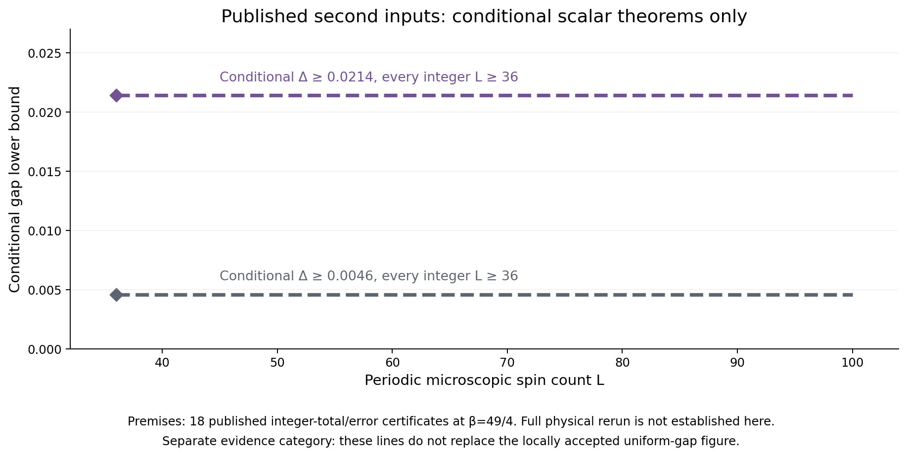
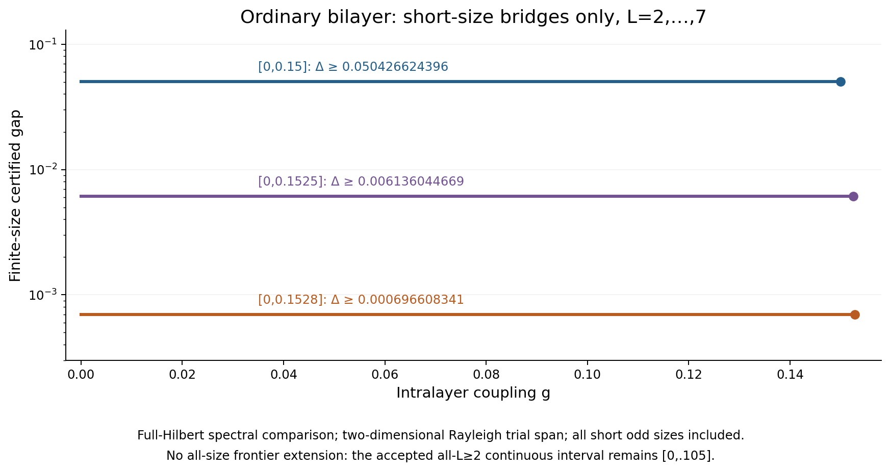

# Stage14: conditional second-input theorems and verified finite-size tools

This snapshot preserves all stage13 locally accepted gap records. New second-input uniform theorems are **conditional on eighteen published physical integer-total/error certificates at β=49/4**. Their exact scalar deductions were independently reviewed; a full local physical rerun of those eighteen inputs is not established here.

## Conditional uniform results, in a separate evidence category

| Conditional gap lower bound | Size scope | Evidence |
|---|---|---|
| .0046 | Every integer L≥36, unique ground | Independently checked original filters and optimized scalar continuation |
| .0214 | Every integer L≥36, unique ground | Independently checked refined signed-moment majorants and continuation |

The model is the uniform periodic spin-1 Heisenberg chain with unit bilinear exchange. Both deductions retain the same eighteen published β=49/4 I/P inputs, lengths 4…12, and the already checked 72-site D26 Rayleigh anchor. Published integer W totals and their stated error certificates are converted to rational trace intervals. This conversion is not physical-column recomputation. The nine locally audited β=21/2 inputs are a different dataset and do not discharge these eighteen premises. Kernel or tiny-fixture acceptance does not do so either.

The .0214 review verifies ten majorants, four whole signed exterior rays, eleven finite integer windows, and an asymptotic onset at 36864 with β=12544. Odd signed moments are retained; no finite-rank transfer assumption or new MPS contraction is introduced. No minimal-seed conclusion follows.

[Separate conditional dataset](conditional_uniform_certificates.csv), [initialization proof](../uniform_second_initialization_review/REVIEW.md), [signed-moment proof](../uniform_second_moment_review/REVIEW.md).

### Locally accepted uniform bounds remain unchanged

The separate locally accepted family remains .0038 for every integer L≥48, .0025 for L≥54, .0068 for L≥56, and .0102 for L≥60. The finite 48…96 bound .0053 overlaps the earlier n52 theorem; infinite bootstrap initialization remains 52. These results include odd lengths and unique ground states. They are not replaced by the conditional .0214 line.

[Locally accepted coverage](uniform_coverage_certificates.csv), [locally accepted large-size certificates](uniform_large_size_certificates.csv), [stage13 evidence](../overview_stage13/README.md).

### Original first and second initializations

The official original first dataset used initialization 60. The official second dataset already used initialization 36 at β49/4, eighteen I/P thermal inputs, and six rounds leading to 2304 at β784. Thus initialization 52 is an improvement over the first-data n60 route only; it is not smaller than every original seed. The original second final theorem was log(20)/784 on even L≥2304. The new all-integer L≥36 conclusions above remain conditional on its published physical inputs.

The retained .0102 comparison concerns certified lower-bound values on overlapping scopes, not seed optimality or estimates of the physical gap. Original matrix-polynomial trace certification does not assume full exact diagonalization. [Original scalar replay and pinned sources](../uniform_second_initialization_review/REVIEW.md), [source scope and original theorem comparison](../uniform_source_scope_review/README.md).

## New accepted short-size bilayer bounds

These certify **only periodic square sides L=2,3,4,5,6,7**, with unique finite-volume ground states:

| Closed coupling interval | Uniform finite-size gap lower bound |
|---|---:|
| [0,.15] | .050426624396 |
| [0,.1525] | .006136044669 |
| [0,.1528] | .000696608341 |

The two-dimensional trial span supplies a Rayleigh upper bound combined with a full-Hilbert second-eigenvalue comparison. Physical spin counts are 8,18,32,50,72,98 and the full spaces are2 raised to those counts, not dimension 2. The proof checks L2 parallel edges, L3 triangles, all short odd sides, fixed rational interval trials and the monotonicity of this particular envelope. Its limiting zero is not a universal no-go. No residual is required merely to certify a Rayleigh upper bound.

**The all-size bilayer frontier is unchanged:** eighty closed pieces cover [0,.105] with gap≥.004499695659 for every integer L≥2; at .105 alone the stronger bound is .031673112867. There is no all-size extension to .1528.

[Separate short-size data](bilayer_short_size_certificates.csv), [independent short-bridge proof](../bilayer_short_bridge_refinement_review/PROOF.md).

## Complete 4×4 second-moment fixture and sector pencil

The accepted [independent fixture and proof](../bilayer_residual_pencil_review/PROOF.md) reconstruct the complete 16D 4×4 H′² coupling polynomial. Fifteen independent support polarizations recover the five-dimensional new U block, all four missing support Gram blocks, and every mixed block. The signed hard-core q8 commutator, including negative terms, is retained. The resulting complete matrix reproduces the earlier full residual polynomial.

The projected expression K G⁻¹ K is not the complete H′² matrix: the positive omitted residual cannot be discarded. The pencil J−(a+ℓ)K+aℓG supplies a ground-energy implication only after separate global ground identification and a valid **full even-singlet sector cutoff**. A full-Hilbert second-eigenvalue bound cannot simply be replaced by the next counting threshold.

This review gives no new gap and no accepted full 8×4 matrix. The ongoing full 8×4 calculation and any subsequent pencil optimization are outside this snapshot.

## Thermal rerun engineering status

- [Kernel review](../uniform_second_thermal_kernel_review/REVIEW.md): exact kernel accepted for lengths 4…12 and I/P seams, with complete independent fixtures at 4 and 5. The old pilot resume wrapper was not accepted for the campaign, and the eighteen full cases were not validated.
- [Strict data-plane review](../uniform_second_thermal_campaign_review/REVIEW.md): checkpoint identity and integer-record contract accepted; fourteen faults rejected. Its historical launch block concerned aggregate accounting, deadlines and worker control.
- [Final supervisor review](../uniform_second_thermal_supervisor_review/REVIEW.md): engineering launch gate PASS after fifteen independent runtime tests. Budget is 21600 aggregate CPU seconds, at most two single-core 256MiB worker trees, campaign deadline 2026-10-11T06:00:00Z. Supervisor overhead is separately charged. One authorized persistent state directory is required; no reset ledger, alternate directory or second instance is allowed.

The supervisor review closes the engineering block but does not itself authorize a launch. Its frozen verdict records **zero thermal jobs executed** and no completed full physical campaign. This overview includes only sealed engineering evidence, not mutable campaign state or outputs. Operational launch/current activity, if separately authorized later, belongs in the root status record and cannot change this snapshot's evidence category.

## Integrity and reproduction

All 320 stage13 main rows, the original finite-chain result, four uniform large-size rows, the finite 48…96 result and its coverage consequence remain unchanged. The three new short-size records and two conditional records are separate datasets. Historical 66/74 and current 80 bilayer pieces are preserved.

Run `bash research_20261010/overview_stage14/REPRODUCE.sh` from the repository root. It hydrates the unchanged [lossless exact-evidence package](../../reproducibility/stage11_exact_evidence/README.md), verifies the preceding overview and all pinned source seals, runs deliberate scope/data corruption tests, and rerenders all PNG/PDF exports byte-for-byte in temporary storage.

[Manifest](MANIFEST_SHA256.json), [frozen status](FROZEN_STATUS.json), [validation](validation.json), [rejection tests](rejection_guards.json), [render replay](render_reproducibility.json), [visual QA](VISUAL_QA.md), [provenance](PROVENANCE.md).
