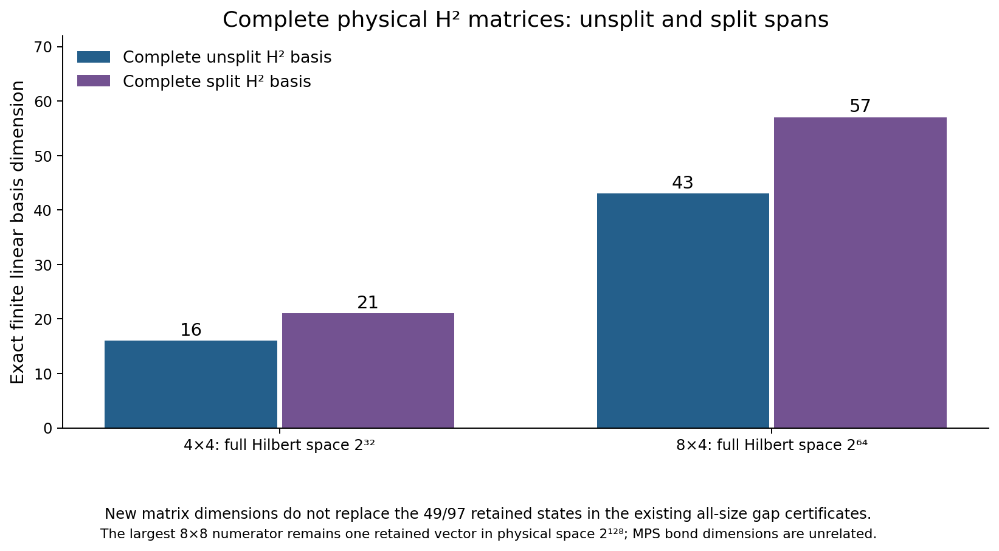
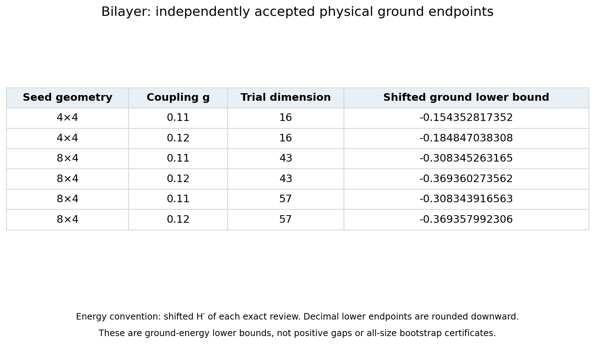

# Stage 15: complete bilayer moments and ground-energy bounds

This reader edition explains the historical snapshot, which preserves every stage14 gap record and its conditional evidence categories. The stage adds complete physical bilayer matrices and ground-energy lower endpoints. The accepted all-size gap cover remains eighty pieces on [0,.105], with gap≥.004499695659 for every integer periodic square side L≥2. The stronger bound at the isolated coupling .105 remains .031673112867. The new matrix and endpoint results do not extend that gap cover.

## Complete physical 8×4 second moments

The [independent 43D matrix review](../bilayer_complete_H2_8x4_review/PROOF.md) accepts the full physical Gram, first moment and complete H′² coupling polynomial for the 8×4 patch. The patch contains 64 spins in a Hilbert space of dimension 2^64. The finite trial basis has dimension 43.

The independent review checks all 4495 fixed-origin q4 supports and 169911 q6 supports, all 784 entries of the four new 14×14 support blocks, and all 5547 entries of the three 43×43 H′² coefficients. For 96705 supports, the M family vanishes while the complete image contributes nonzero terms. Their TT trace 4505303808 is retained. The signed hard-core commutator, including negative terms, reconstructs the complete q8 Gram. All mixed blocks and the earlier full residual polynomial agree exactly.

A projected K G⁻¹ K is not the physical second moment. The omitted residual must remain in J. Matrix acceptance alone proves neither a new ground endpoint nor a gap.

## Split R/M matrices

The independently accepted [21D 4×4 split fixture](../bilayer_split_H2_fixture_review/PROOF.md) and [57D 8×4 complete split matrix](../bilayer_complete_split_H2_8x4_review/PROOF.md) separate R and M instead of forcing the old U=R+M combination.

The 8×4 basis consists of B15,L14,R14,M14 and has dimension 57 in the same physical 2^64 space. Five oriented 14×14 blocks supply 980 independently checked entries. The cross blocks are nonsymmetric and must retain their orientation. All 9747 entries of the three 57×57 H′² coefficients are reconstructed independently. The embedding cR=cM recovers every 43D Gram, first-moment and complete second-moment coefficient exactly. The full q8 contribution and zero-M/nonzero-image terms remain present.

A complete residual-block Gram is positive semidefinite. Compression and positivity checks supplement the independent support contractions. By themselves they would not certify the missing physical cross entries.

[New matrix dimensions](stage15_matrix_dimensions.csv).

The new 21D/57D matrices do not change the existing gap pipeline's retained denominator counts 49/97 or total trial spans 64/139. The accepted largest 8×8 numerator still retains one vector from its 43D search in physical Hilbert space 2^128. These linear dimensions are unrelated to MPS bond dimensions.

## Accepted ground-energy lower endpoints

The [16D/43D physical endpoint review](../bilayer_residual_pencil_optimization_review/PROOF.md) proves four lower endpoints at the isolated couplings .11 and .12. Displayed twelve-decimal values are rounded downward in the shifted H′ normalization of the review:

| Patch | Coupling | Trial span | Shifted ground lower bound |
|---|---:|---:|---:|
|4×4|.11|16|−.154352817352|
|4×4|.12|16|−.184847038308|
|8×4|.11|43|−.308345263165|
|8×4|.12|43|−.369360273562|
|8×4|.11|57|−.308343916563|
|8×4|.12|57|−.369357992306|

The [57D endpoint review](../bilayer_split_pencil_optimization_review/PROOF.md) additionally accepts the two split-basis 8×4 endpoints above. Exact positive gains over the 43D bounds are recorded in the dataset. These improvements are ground-energy endpoints only.

The proof separately identifies the unique global ground below r1 and verifies 96 fresh odd-mode coupling checks. Only after the full reference count is exhausted can r2 serve as a cutoff in the **full even-singlet sector**. It is not the full-Hilbert second eigenvalue. A negative complete pencil J−(a+ℓ)K+aℓG then gives the claimed endpoint.

[Exact endpoint fractions and provenance](bilayer_ground_endpoint_certificates.csv).

Two selected .11 target pencils have 43 strictly positive exact LDL pivots. The 57D review independently obtains 57 positive pivots for each of those targets. This excludes negative-pencil witnesses only within the respective fixed 43D or 57D span and fixed r2 cutoff, for those two thresholds. It does not establish necessary startup thresholds, a universal bootstrap obstruction, or a physical-gap no-go.

### Scope of the floating-point diagnostics

Seven sampled temperatures β=8,9.4,10,11,12,13,15 were tested at each of g=.11 and .12. No tested path yielded a certificate. These are floating scalar diagnostics for that finite sample, not exact all-temperature exclusions. Their hypothetical ground-uncertainty targets and sensitivity substitutions are not physical thermal certificates. See the [sealed diagnostic snapshot](../bilayer_residual_pencil_optimization_review/snapshot/assessment/ASSESSMENT.md) and the review's explicit scope limits.

## Uniform second-input status remains conditional

The .0046 and .0214 theorems for every integer L≥36 remain conditional on all eighteen published β=49/4 physical integer-total/error certificates. The locally accepted uniform family remains .0038 for L≥48, .0025 for L≥54, .0068 for L≥56, and .0102 for L≥60. No partial thermal rerun can promote the conditional rows.

The original first initialization was 60, while its second initialization was already 36. The newer initialization 52 improves the first-data n60 route only. Existing physical coverage starts at 48 by a finite 48–96 bridge while that infinite bootstrap initialization remains 52.

[Conditional dataset, unchanged](conditional_uniform_certificates.csv), [locally accepted coverage, unchanged](uniform_coverage_certificates.csv), [stage14 context](../overview_stage14/README.md).

### Independently accepted partial physical campaign

The [sealed partial review](../uniform_second_thermal_partial_review/OUTCOME_REVIEW.md) accepts sixteen complete physical cases, lengths 4–11 with both identity and parity seams. Each reproduces the exact published integer W. It validates 990 saved batches: 962 from complete cases plus 28 incomplete L12 batches. **Both L12I and L12P remain incomplete**, so neither .0046 nor .0214 is promoted from its conditional category. [Per-case evidence](thermal_partial_cases.csv).

The immutable terminal snapshot records the **historical status at 2026-10-10 23:59 UTC**: BUDGET_RESERVATION_EXHAUSTED, 16207 CPU seconds charged, 5393 remaining ledger capacity, including 14640 retained charges for failed/unknown reservations. The remaining capacity cannot fund the next 7320-second reservation. No charge is refunded and no reset or restart is authorized by that review. The cause analysis records child SIGKILL and strongly supports the runner invocation-budget boundary as the cause. No per-kill kernel diagnosis was recorded. The earlier scheduling fixtures had not tested a successful batch sequence approaching that boundary.

Only the frozen partial review and its copied evidence are pinned here. Pending repair reviews and budget-extension design are excluded. The root documents record subsequent operational status. This partial result describes the historical checkpoint. The mutable campaign ledger and outputs are excluded. Repair or budget-extension design does not itself authorize execution. Any independently reviewed continuation gate remains separate from these historical physical results.

## Reproduction and preservation

All prior main claims, locally accepted uniform records, conditional records, short-size bridges and historical interval alternatives remain unchanged. New ground endpoints and matrix dimensions are separate data tables. This overview verifies source integrity and scoped extraction. The linked independent reviews contain the physical and exact scalar proofs.

Run `bash research_20261010/overview_stage15/REPRODUCE.sh` from the repository root. It first hydrates the unchanged [lossless exact-evidence package](../../reproducibility/stage11_exact_evidence/README.md), checks stage14 and all final source seals, runs deliberate corruption tests, and regenerates every PNG/PDF byte-for-byte in temporary storage.

[Manifest](MANIFEST_SHA256.json), [frozen status](FROZEN_STATUS.json), [validation](validation.json), [rejection tests](rejection_guards.json), [render replay](render_reproducibility.json), [visual QA](VISUAL_QA.md), [provenance](PROVENANCE.md).
