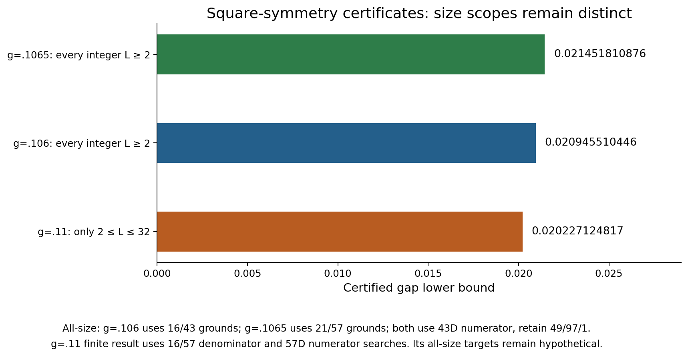

# Stage 16 square-symmetry bootstrap and the scope of the new bounds

Every stage 15 result is preserved. New bilayer bounds distinguish all-size certification from finite-size windows, actual inputs from hypothetical targets, and selected trial searches from larger ambient matrices.

## New physical gap certificates

**The entire closed interval [0,.1065] is certified** by 82 closed pieces, with a uniform gap≥.004499695659 and a unique ground state for every integer square side L≥2. The final new piece [.106,.1065] has gap≥.019955613868. [Final interval proof](../bilayer_symmetry_interval_01065_review/PROOF.md).

The separately preserved intermediate [closed-interval review](../bilayer_symmetry_interval_0106_review/PROOF.md) proves **gap≥.020881493369 throughout [.105,.106]** for every integer L≥2. Joined with the previous eighty pieces, **81 closed pieces cover [0,.106] with uniform gap≥.004499695659** and a unique ground state. No physical-gap monotonicity is assumed. [Current pieces](ordinary_interval_pieces.csv), [historical 80-piece cover](historical_interval_pieces_stage15.csv).

- At **g=.1065**, gap **≥.021451810876** for every integer periodic square side **L≥2**, with a unique ground state in the full Hilbert space. [Independent optimized-point review](../bilayer_g01065_optimized_point_review/PROOF.md).
- At **g=.106**, gap **≥.020945510446** for every integer periodic square side **L≥2**, with a unique ground state in the full Hilbert space.
- At **g=.11**, gap **≥.020227124817** only for every integer **2≤L≤32**, with a unique ground state in the full Hilbert space. This is not an all-size .11 certificate.

[All-size point review](../bilayer_g0106_symmetry_point_review/PROOF.md), [finite .11 review](../bilayer_g011_symmetry_scalar_review/PROOF.md), [finite-size data](stage16_finite_bilayer_certificates.csv).

### Search dimensions and physical spaces

The .106 all-size proof selects denominator vectors from **16D/43D searches**, and one numerator Rayleigh vector from a **43D search**. Their embeddings in complete 21D/57D matrices do not make those the searches used by this certificate. The retained counts remain 49/97/1, and the total denominator spans remain 64/139. The physical spaces have dimensions 2^32,2^64,2^128 for the 4×4,8×4,8×8 patches, respectively.

At .1065, the actual selected denominator searches are **21D/57D**, with a **43D numerator search**, retaining 49/97/1. These new rational ground witnesses were checked exactly. Floating-point eigensolver proposals are not certificates. [Per-route dimension table](stage16_gap_route_dimensions.csv).

The separate finite .11 proof uses 16D/57D denominator searches and a 57D numerator search, still retaining 49/97/1. These finite-branch dimensions must not be silently substituted into the .106 all-size proof. None is an MPS bond dimension.

## Square-isotropic analytic mechanism

The accepted [direct-window theorem](../bilayer_square_symmetry_window_review/PROOF.md) takes raw txy inputs

a≤T(n,n;β), b≤Sx(n,n;2β), c≤Sy(2n,n;2β), for even n≥2.

For its positive domain, the window lower bound is

a⁴(2b−1) sqrt(2b² sqrt(2c−1)−1),

covering all integer rectangles n≤L,W≤2n. The canonical middle entry is not the raw b coordinate. Square isotropy permits the correctly reflected identities. It does not equate the x and y purities on the same fixed nonsquare rectangle.

The independently reviewed [stronger recurrence](../bilayer_square_symmetry_recurrence_review/PROOF.md), with G(z)=1−(1−z)²/(2z²), gives

a′=G(a⁴b²c), b′=G(a′c²), c′=G(c⁴a′²b′).

Every update requires a positive lower bound and retains its exact geometry/temperature. The new raw base is (2n,2n,2β). The improved middle edge follows from physical reflection and partition cancellation, not rectangular axis relabeling. Recurrence positivity alone does not prove a finite-window gap. Each application must also verify every finite window and asymptotic closure.

The .11 review also checks two hypothetical implications requiring unproved improvements to ground32 .0002743 or .0002847. Their conditional all-size conclusions are not physical certificates and are not inserted into the main gap dataset.

## Scoped higher-moment work

[Small physical m3/m4 fixtures](../bilayer_krylov_m4_fixture_review/PROOF.md) independently compare fifteen terms on 4×2 and 5×2 using a Cartesian rung representation checked against the spin-half edge. The 5×2 q10 integer T norm is 452758284. There is no accepted 8×4 m4 support run, production-cost certification, new ground endpoint or gap here.

The [normal-ordering and envelope-barrier review](../bilayer_next_residual_direction_review/PROOF.md) checks signed noncommuting identities and a fixed two-vector Krylov envelope limitation for selected targets. A verified global spectral envelope can upper-bound m4, but a hypothetical target cannot replace its certified lower endpoint. Scalar m3 alone does not provide every cross entry for an augmented full basis. The barrier applies only to this envelope and target construction. It does not establish a universal obstruction to m4, Krylov methods or a physical gap.

## Thermal engineering and unchanged conditional uniform status

The sealed [repair engineering review](../uniform_second_thermal_repair_review/REVIEW.md) accepts design and fixtures for an append-only cumulative cap 21600→43200 CPU seconds, retaining 16207 previously charged seconds, the same state path, the same 06:00 UTC deadline and at most two worker trees of 256 MiB each. Nineteen extension tests and the actual invocation-boundary regression pass. Batches are bounded by a fixed internal allowance rather than a shrinking near-boundary allowance. The review executes zero thermal commands and does not discharge the missing physical inputs.

The immutable stage 15 partial snapshot still records sixteen accepted complete cases, lengths 4–11 with I/P seams. L12I/P are unresolved within this overview's sealed physical evidence. Any ongoing continuation is operational state belonging to root documents. No mutable ledger or partial output is included here.

Accordingly **.0046 and .0214 for all integer L≥36 remain conditional** on all eighteen published β=49/4 integer-total/error certificates. The locally accepted uniform family remains .0038 for L≥48, .0025 for L≥54, .0068 for L≥56 and .0102 for L≥60. Its initialization remains 52, while the original second initialization was already 36. The separate [conditional dataset](conditional_uniform_certificates.csv) is unchanged.

## Integrity and reproduction

[Stage15](../overview_stage15/README.md) remains immutable, including its historical thermal stop at 2026-10-10 23:59 UTC. Every previous main row, finite result, conditional record and interval alternative is preserved. New all-size rows are added only from finalized independent reviews. Hypothetical targets remain in evidence records with their scope explicitly stated.

Run `bash research_20261010/overview_stage16/REPRODUCE.sh` from the repository root. It hydrates the unchanged [exact-evidence transport](../../reproducibility/stage11_exact_evidence/README.md), checks stage 15 and all source seals, rejects deliberate corruptions and reproduces every PNG/PDF byte-for-byte.

[Manifest](MANIFEST_SHA256.json), [frozen status](FROZEN_STATUS.json), [validation](validation.json), [corruption tests](rejection_guards.json), [render replay](render_reproducibility.json), [visual QA](VISUAL_QA.md), [provenance](PROVENANCE.md).
