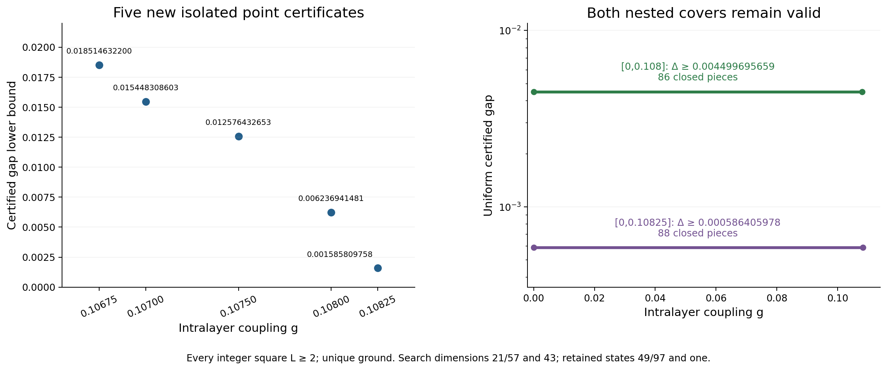

# Stage 17. Nested bilayer covers and five frontier points

This immutable overview extends [stage 16](../overview_stage16/README.md). Every prior dataset and scientific row is preserved. Hamiltonians, units and periodic small-size conventions remain those in [the model specification](../MODELS_AND_NORMALIZATION.md). This is an exact extraction and integrity check of independently sealed reviews, not a new physical-proof audit.

## Accepted positive certificates

For the ordinary spin-half bilayer, every integer periodic square side L≥2 has a unique full-Hilbert ground state and the following certified gap lower bounds.

| Coupling scope | Gap lower bound | Closed pieces |
|---|---:|---:|
| Every real g in [0,.108] | .004499695659 | 86 |
| Every real g in [0,.10825] | .000586405978 | 88 |
| g=.10675 | .018514632200 | point |
| g=.107 | .015448308603 | point |
| g=.1075 | .012576432653 | point |
| g=.108 | .006236941481 | point |
| g=.10825 | .001585809758 | point |

Both nested interval certificates remain valid. Broadening the range does not erase the stronger lower bound on [0,.108]. Four new closed pieces cover [.1065,.108] with minimum .005329481750. Two more cover [.108,.10825] with minimum .000586405978. No physical-gap monotonicity or interpolation between isolated points is assumed.

[All model bounds](certified_bounds.pdf), [all 88 exact pieces](ordinary_interval_pieces.pdf), [exact nested records](stage17_nested_covers.csv), [all exact main rows](certified_bounds.csv). The older frontier zoom is explicitly historical through .1065. The new figure above shows the five new points.

New selected denominator ground searches have dimensions 21/57. The numerator search has dimension 43 but retains one Rayleigh vector. Denominator traces retain 49/97 states. Physical Hilbert spaces remain 2^32,2^64,2^128. These are separate from MPS bond dimensions. Historical .106 uses selected 16/43 searches embedded in 21/57 matrices. Its dimensions are not retroactively relabeled.

## Independent proof scope and diagnostics

- [Four-point review](../bilayer_symmetry_frontier_010675_0108_review/PROOF.md) checks the rational physical vectors and exact scalar paths. [Four-piece interval review](../bilayer_symmetry_interval_0108_review/PROOF.md) certifies every real coupling in its closed pieces.
- [The .10825 review](../bilayer_symmetry_frontier_010825_review/PROOF.md) certifies that point and separately replays one failed lower-bound path at g=.1085, initial beta 19/2, failing at n128 after four windows. This is a scoped failure of sufficient bounds. The producer's finite floating-temperature screen is diagnostic and was not independently researched as an all-temperature exclusion. It gives no universal no-go. g=.109 is untested in this snapshot.
- [The final interval review](../bilayer_symmetry_interval_010825_review/PROOF.md) explicitly preserves the stronger nested 86-piece certificate while accepting the broader 88-piece certificate.
- [Nearest-neighbor pair-product review](../bilayer_pair_product_review/REVIEW.md) establishes the following. For the periodic 8×4 NN hard-core pair state at g=11/100 and z=−11/400, the variance is at least .00546193724126837… . The exact rational is retained in the evidence. The same-sublattice two-triplet residual has squared numerator 1056 g² z² and norm upper bound (1+48|z|²)^16. Independent geometry gives sum n_uv²=352. This is a fixed-parameter residual obstruction, not an exclusion of all z, an optimized family or dressed states. No new ground endpoint or gap is inferred. Transfer dimensions, storage and insertion counts are formal cost warnings. Proposed dressing corrections are untested and do not establish feasibility.

## Uniform chain and thermal scope

Locally accepted uniform-chain bounds remain .0038 for every integer L≥48 (bootstrap initialization 52), .0068 for L≥56 and .0102 for L≥60. The historical weaker L≥54 certificate remains preserved. The .0046/.0214 bounds for every integer L≥36 stay in the separate conditional dataset, based on 18 published second-initialization thermal certificates. Only 16 full physical cases have an immutable independent local acceptance. L12 I/P remain pending here. No mutable campaign ledger, in-progress batches or later operational status enters this snapshot. Consult root status documents for timestamped campaign operations.

Original first initialization was 60 and original second initialization already 36. Seed 52 improves the first-data route, not all original seed sizes. The source-scope and license supplements, precise original theorem comparison and all prior exclusions remain intact in the inherited records.

## Reproduction and integrity

Run `bash research_20261010/overview_stage17/REPRODUCE.sh` from the repository root. It first hydrates the [lossless stage 11 evidence package](../../reproducibility/stage11_exact_evidence/README.md), verifies the final snapshot and prior stage, checks complete selected review manifests and exact data, runs corruption guards, and renders into a temporary directory for byte comparisons. Existing source/review seals are unchanged. CPU 8, one numerical thread, 1 GiB address-space cap. No root files or remote repository are modified.

[Validation](validation.json), [corruption checks](rejection_guards.json), [render replay](render_reproducibility.json), [visual QA](VISUAL_QA.md), [source seals](ACCEPTED_REVIEW_SEALS.json), [freeze record](FROZEN_STATUS.json), [manifest](MANIFEST_SHA256.json).
