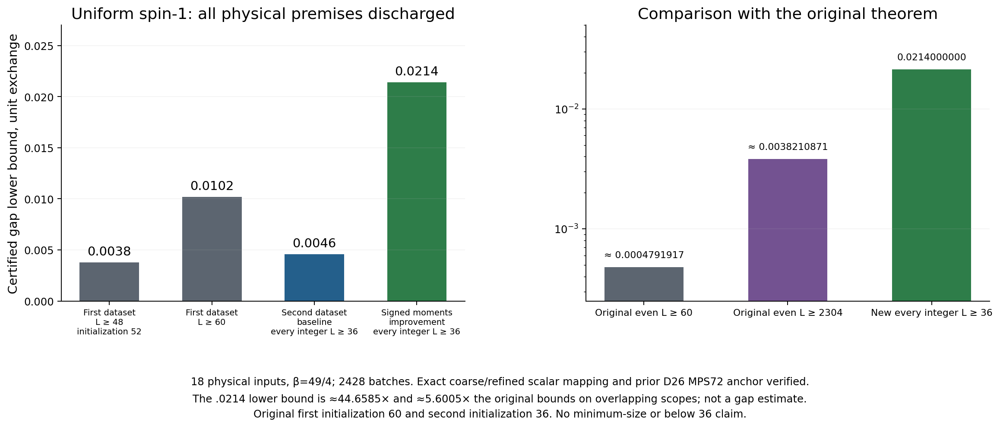

# Stage18: uniform gap .0214 with all physical premises reproduced

For the untwisted periodic uniform spin-one Heisenberg chain with unit bilinear exchange, **every integer length L≥36 has a unique ground state and gap at least .0214**. The weaker .0046 bound on the same scope is independently discharged too. The [final physical review](../uniform_second_thermal_full_review/PROOF.md) verifies all18 thermal inputs and their exact mapping to both previously accepted scalar proofs and the prior72-site D26 MPS anchor. No minimum-size or below36 claim follows.

[New local theorem records](stage18_local_uniform_certificates.csv), [all18 thermal cases](stage18_thermal_cases.csv), [exact provenance mapping](../uniform_second_thermal_full_review/provenance_results.json). The scalar proofs themselves are unchanged. The original conditional rows remain byte-identical historical records; their premises are now discharged by the new review. Historical figures in this overview are labeled accordingly. [Stage17](../overview_stage17/README.md) and every older snapshot remain untouched.

## Physical input reproduction and normalization

At beta49/4, the18 inputs comprise lengths4–12 with identity and pi-twisted seams, including odd lengths. All2428 saved batch aggregates, independent physical sparse-matrix digests, orbit representatives/multiplicities, exact integer totals and rigorous error intervals pass. This is matrix-polynomial column evaluation with certified errors, not an assumption of full exact diagonalization.

The final L12 integer totals are1266666171463993322695232916 (I) and524785463625387865619045258 (P). The independently checked physical enclosures reproduce both the coarse .0046 premises and the tighter10^-18 rounded signed J/N intervals used by the .0214 proof. Coarse interval containment alone would not suffice for the latter.

The MPS72 input is the previously physically rebuilt bond-dimension26 state. Exact file identity, positive norm, one-bond numerator normalization and negative total shifted Rayleigh quotient match both proofs; no new MPS contraction is claimed. Physical Hilbert spaces for the thermal inputs are3^4 through3^12, distinct from bond dimension26 and physical72-site size.

The immutable2979-file campaign ZIP and its per-entry hashes are verified directly. The sealed producer export is `uniform_second_thermal_campaign_complete`, manifest17110955acc17821025bab5c1609706273510de6c8c2a31eb7184d693a9b9156. Terminal charge27543 of43200CPU seconds retains the original16207 charges. Historical failures, partial review and all previous evidence remain unchanged. No mutable campaign path is used.

The .0214 certified lower bound is approximately44.6585 times the original first bound(4/105)log(80/79), and5.6005 times the original asymptotic bound log20/784, on overlapping scopes. Original final theorems cover even L≥60 and even L≥2304 respectively; this new theorem covers every integer L≥36. These are ratios of sufficient lower bounds, not estimates of the physical gap. Original first initialization was60; the original second initialization already36. The earlier new52 route improves the first dataset, not all original seeds.

## Bilayer: complete58D physical matrix and finite-seed endpoints

The ordinary bilayer uses unit rung exchange and intralayer exchange g, with the periodic multiedge conventions in [Models and normalization](../MODELS_AND_NORMALIZATION.md). For the 8×4 seed (32 rungs, 64 spins), H′=H+24I=Q+(g/2)A. The finite-seed endpoints below use this shifted convention.

Positive-gap certificates are unchanged: every real g∈[0,.108] has lower bound .004499695659 (86 closed pieces), and every real g∈[0,.10825] has lower bound .000586405978 (88 pieces), for every integer periodic square side L≥2 with unique ground. Both nested certificates remain preserved.

The [independent full-row review](../bilayer_complete_residual_direction_58d_review/PROOF.md) contracts all4495 fixed-origin q4 supports and169911 q6 supports. All174 new G/H200/H200² entries and290 coupling-polynomial entries agree, including76566 supports where old M channels vanish but T does not and1019466 translation-anchor checks. Full signed q8 contributions and separate exact N/4,N/6 normalization are retained.

These are complete physical moments within the58D trial basis, incorporating the accepted57×57 block. Gram rank is58. At g=.11 the116D basis/Hamiltonian-image block Gram is positive semidefinite with rank87. These checks supplement the physical contractions; they do not replace them. Physical Hilbert dimension of the8×4 seed is2^64.

The [separate endpoint review](../bilayer_residual_direction_58d_algebra_review/PROOF.md) accepts unique-global-ground identification and finite8×4 shifted-ground lower bounds:

| g | Search dimension | Safe downward-rounded lower endpoint |
|---|---:|---:|
| .1085 | 58 | −.299703121631 |
| .11 | 58 | −.308337477991 |

[Exact endpoint records](stage18_ground_endpoint_certificates.csv) also preserve gains over fresh57D vectors. These are ground-energy endpoints, not gaps or new coupling intervals. Four target pencils are positive definite only within the current58D/fixed-r2 setting. Producer finite-temperature failures are scoped diagnostics, not independently rerun universal exclusions. Full untruncated even-singlet cutoffs and complete odd-sector counts are distinguished from full-Hilbert second-eigenvalue bounds.

Latest frontier gap routes still use21/57 denominator searches and43 numerator search, retaining49/97/1 states; historical routes retain their own dimensions. The new58D endpoint basis does not retroactively replace those dimensions.

## Engineering scope

The [physical fixture](../bilayer_residual_direction_fixture_review/PROOF.md), [corrected inner gate](../bilayer_residual_direction_production_gate_review/PROOF.md), and [sole-path outer gate](../bilayer_residual_direction_outer_gate_review/PROOF.md) have separate scopes. The outer gate accepts its fixed46-call nominal350+10=360CPU-second reserved path and lifecycle/accounting design; it does not guarantee completion or unrelated optimization runtimes.

The58D endpoint mathematics passes independently. **Producer optimization resource compliance remains UNVERIFIED.** Its [separately sealed clarification](../bilayer_residual_direction_58d_algebra/RESOURCE_CLARIFICATION.md) records a33.13448-second child CPU report despite a configured25-second hard limit, incomplete total accounting, and no verified60CPU-second total bound. The addendum is preserved, not promoted to engineering PASS. The independent physical-row and endpoint audits have their own measured, bounded runs. No new compiler work or active plans are included.

## Reproduction and integrity

Run `bash research_20261010/overview_stage18/REPRODUCE.sh` from the repository root. It hydrates the [inherited lossless evidence package](../../reproducibility/stage11_exact_evidence/README.md), verifies frozen source seals, the2979 ZIP entries and prior snapshot bytes, runs exact extraction/corruption guards, and rerenders to a temporary directory for byte comparisons. It launches no thermal kernel, physical full-support pass or endpoint optimization. CPU8, one numerical thread,1GiB address-space cap. Root documents and remote publication are outside this snapshot builder.

[Validation](validation.json), [corruption checks](rejection_guards.json), [render replay](render_reproducibility.json), [visual QA](VISUAL_QA.md), [review seals](ACCEPTED_REVIEW_SEALS.json), [freeze record](FROZEN_STATUS.json), [manifest](MANIFEST_SHA256.json).
