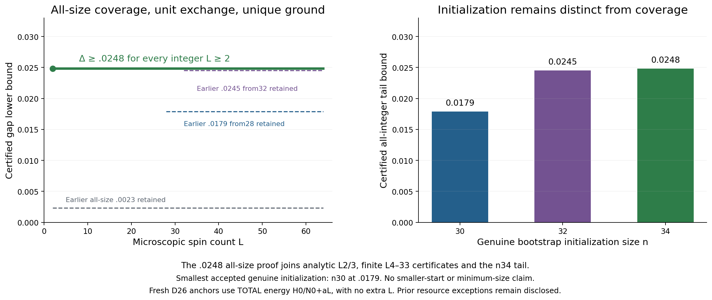

# Stage19: uniform gap .0248 for every integer length L≥2

For the untwisted periodic uniform spin-one Heisenberg chain with unit bilinear exchange, **every integer L≥2 has a unique ground state and gap at least 31/1250=.0248**. The [final independent review](../uniform_gap_0248_all_sizes_review/PROOF.md) joins analytic L2/3, exact finite certificates for L4–33, and the independently initialized n34 tail. This is a rigorous lower bound, not an estimate of the physical gap.

**Coverage starts at 2; this strongest proof uses bootstrap initialization 34.** The smallest separately accepted genuine initialization is 30, with gap .0179. No initialization below30, minimum-size theorem or optimality claim is made.

[Exact coverage records](stage19_uniform_coverage.csv), [genuine initializations](stage19_uniform_initializations.csv), [finite certificates](stage19_uniform_finite_certificates.csv), [historical isolated24 record](stage19_uniform_isolated.csv). All [stage18](../overview_stage18/README.md) science and prior snapshots remain unchanged, including the earlier .0214/.0046 local theorems and the historical conditional records whose physical premises were discharged in stage18.

## Initialization and finite coverage are different claims

The [core smaller-initialization review](../uniform_smaller_second_initialization_review/PROOF.md) accepts three genuine canonical starts at beta 49/4:

| Initialization n | Every integer length | Certified gap lower bound | Fresh physical MPS anchor |
|---:|---|---:|---:|
| 34 | L≥34 | .0248 | 68 |
| 32 | L≥32 | .0245 | 64 |
| 30 | L≥30 | .0179 | 60 |

The separate [28–56 bridge](../uniform_n28_second_initialization_review/PROOF.md) extends .0179 coverage to28 while retaining initialization 30. The [26/27 parity prefix](../uniform_n26_second_coverage_review/PROOF.md) gives .0023 from26. [Isolated24](../uniform_n24_second_coverage_review/PROOF.md) and [direct25](../uniform_direct25_coverage_review/PROOF.md) then join coverage from24. The [small-length completion](../uniform_small_lengths_completion_review/PROOF.md) first proves .0023 for every L≥2. All these valid, weaker records are preserved. None of these finite extensions alone creates a smaller bootstrap start.

The final strengthening rechecks the cached L4–25 purity inequalities at .0248, independently reconstructs fresh L26–33 MPS integers and inequalities, verifies analytic L2/3, and joins the n34 tail. It retains the stronger all-size value .0248, rather than silently attributing that value to the n30 tail.

## Physical inputs, normalization and exact proof labels

The18 beta 49/4 I/P thermal inputs for lengths4–12 were fully reproduced and independently accepted in stage18. The refined signed J/N moments, complete signed support, multiplicity3 and directed rational endpoints remain the same physical premises. No new thermal campaign or printed-only premise is introduced.

The real D26 site tensors and physical insertion are reconstructed for fresh anchors. H0 is already the TOTAL periodic Hamiltonian numerator. The shifted trial quotient is H0/N0+aL, a=700741/500000, without another factor L. This differs from the older MPS72 one-bond numerator convention, which remains explicitly preserved in its historical record. Trial span dimension 1, MPS bond dimension 26, norm-transfer dimension 676, physical Hilbert dimension 3^L and abstract thermal-transfer rank are distinct quantities.

For the direct odd25 proof, the shifted trial energy is positive, approximately .0042115764. Its thermal numerator is a lower bound on exp(−2βEtrial), below1; it is never replaced by1 or by a negative-energy anchor. Odd trace denominators use signed-transfer Cauchy–Schwarz between adjacent even physical traces. Exact purity above1/2 and a strict directed exponential inequality certify the finite gap and uniqueness. The stronger finite prefix preserves each method’s physical input and error convention. Its L24 certificate is parity-resolved and uses the previously accepted MPS48 anchor; it is not an own-length MPS24 direct thermal proof. The target space 3^24 and anchor space 3^48 are kept distinct. Own-length direct thermal trials cover L4–23 and L25–33.

At L2, periodic bonds are doubled: H2=2 S1·S2, with total-spin energies−4,−2,2, unique singlet ground and gap2. At L3, H3=(S_total²−6)/2, with unique singlet ground and gap1. These explicit analytic certificates complete the two lengths below the transfer identity's L≥4 scope. Model and boundary conventions are retained in [Models and normalization](../MODELS_AND_NORMALIZATION.md).

## Bilayer results and local compiler scope

No new bilayer gap is claimed. The stronger nested86-piece [0,.108] bound .004499695659 and broader88-piece [0,.10825] bound .000586405978 remain separate, each for every integer square side L≥2. Existing58D endpoint mathematics stays accepted, with its producer resource compliance UNVERIFIED.

The [connected-rule review](../bilayer_connected_rule_compiler_review/REVIEW.md) accepts local algebra only: 297237 rules, 121251328 implicit entries and full small Cartesian fixtures. Checkpoint hardening remains incomplete and is not promoted to production acceptance.

The [Cartesian indexed-action review](../bilayer_cartesian_indexed_review/REVIEW.md) checks 23040 output-channel coefficients across 3 families×512 targets×15 channels, including 285 zero-source targets per family. It verifies 305233 local rule records and full4×2/5×2 fixtures. Its empirical three-action projection is 2716.661846390625 CPU seconds, failing the proposed 180-second gate.

The [Brauer review](../bilayer_brauer_rule_review/REVIEW.md) checks 58000 independent diagram-composition cases, 17107 diagram records and the same 23040 sampled output channels. Closed color loops contribute exactly3, and oriented terms and spectators are retained. Its smaller empirical action projection, 764.1810277910156 CPU seconds, still fails the 180-second gate. These samples are neither worst-case runtime certificates nor fundamental infeasibility proofs. No full8×4 q6 sweep, full m4 certificate or new gap is promoted. Active implementation-gate work and the new proof guide are excluded from this snapshot.

## Resource exceptions remain visible

The direct25 mathematics is accepted, but its [RESOURCE_ANOMALY.json](../uniform_direct25_coverage_review/RESOURCE_ANOMALY.json) explicitly rejects reviewer resource-budget compliance: 25.9614 process CPU seconds were reported despite an asserted 15-second limit. Actual post-exec limits and external wait4 timing were not retained; the cause remains unresolved. The recorded CPU is not relabeled wall time. This is not a resource-gate PASS.

Later small-prefix and strengthening reviews separately pass guarded runs with checked post-exec limits, independent wait4 clocks and wall watchdogs. Their successful controls do not erase the historical direct25 anomaly or the earlier58D producer runtime exception. This overview performs no new physical contraction, thermal computation, compiler campaign or retry.

## Reproduction and integrity

Run `bash research_20261010/overview_stage19/REPRODUCE.sh` from the repository root. It first hydrates the [lossless inherited evidence package](../../reproducibility/stage11_exact_evidence/README.md), checks the previous immutable snapshot and selected complete review seals, verifies exact source pointers, sizes, normalization and scopes, rejects adversarial corruptions, and rerenders into a temporary directory for byte comparisons. CPU8, one numerical thread,1GiB address-space limit. No root documents or remote repository are edited.

[Validation](validation.json), [corruption tests](rejection_guards.json), [render replay](render_reproducibility.json), [visual QA](VISUAL_QA.md), [review seals](ACCEPTED_REVIEW_SEALS.json), [freeze record](FROZEN_STATUS.json), [manifest](MANIFEST_SHA256.json).
