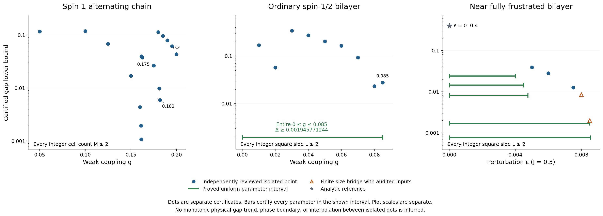
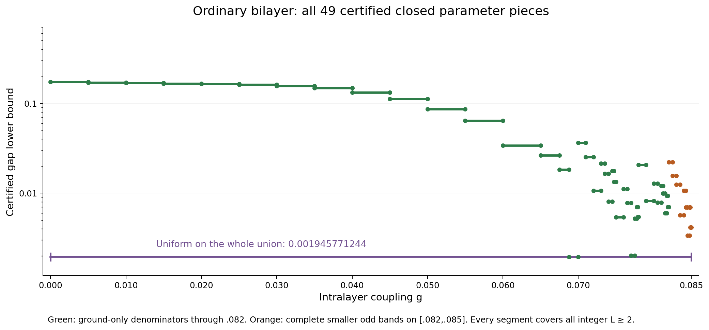
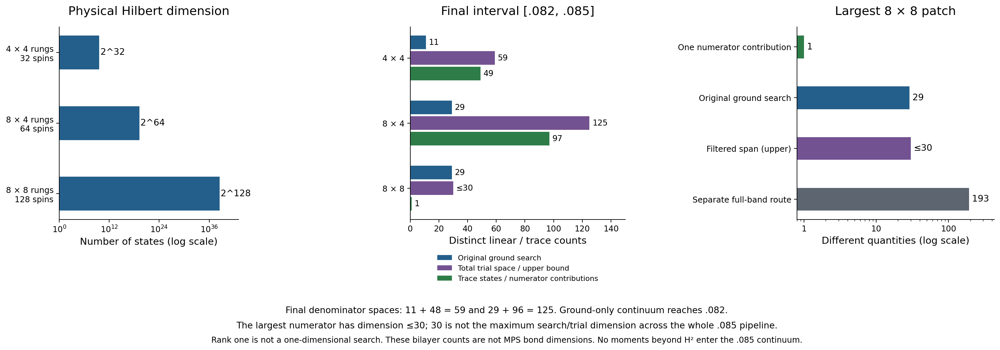
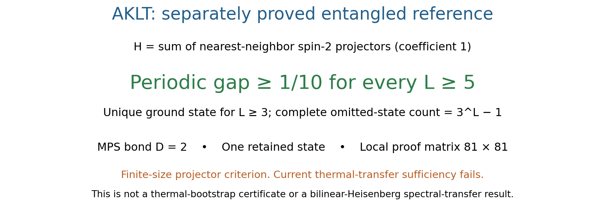

# Certified results and dimension accounting: stage7

Updated 2026-10-10 17:12 EDT (America/New_York, UTC−4) / 21:12 UTC. Extraction timestamp: **2026-10-10T21:14:00.465763+00:00**.

This new immutable snapshot extends [stage6](../overview_stage6/README.md), preserving every prior file and accepted alternative. It extracts independently sealed results and redraws static figures. It does not perform new spectral research or re-audit each mathematical proof.

## Current certified results

- **Ordinary square bilayer: every real 0≤g≤0.085, every integer L≥2, gap ≥0.001945771244.** The exact cover has 49 adjacent closed pieces. The isolated g=0.085 certificate is stronger, **0.027887084487**, and remains a separate claim.
- **Alternating spin-1 chain: isolated g=0.2, every integer M≥2, gap ≥0.043446395688.** The new counted-band route also certifies g=0.18, 0.185, 0.19 and 0.195. No continuous chain interval is inferred.
- **Separate AKLT projector reference: periodic L≥5, gap ≥1/10**, with one D=2 MPS ground state. This uses a finite-size projector criterion; it is not a thermal-bootstrap success.
- The new third-moment 43-dimensional g=0.09 proposal is unreviewed and excluded from all certified figures. This snapshot is frozen without waiting for that work.



[Vector PDF](certified_bounds.pdf) · [All exact thermal certificate rows](certified_bounds.csv) · [Strongest isolated points](latest_point_bounds.csv) · [Full exact data and provenance](overview_data.json)

## Models, normalization and size scope

The alternating spin-1 chain has unit strong-bond exchange and weak exchange g; M counts two-spin cells. The ordinary spin-1/2 square bilayer has unit rung exchange and straight intralayer exchange g in both directions and layers, with no crossed bonds. The near-fully-frustrated bilayer is a different model: fixed J=0.3, straight exchange J+ε and crossed exchange J.

These three thermal-bootstrap families use periodic boundary conditions and retain positive-direction bond multiplicities at side/cell count two. Positive chain bounds cover every integer M≥2; positive square-bilayer bounds cover every integer L≥2. Each certifies a unique finite-volume ground state. No arbitrary-rectangle or infinite-volume-uniqueness conclusion is inferred, apart from the explicitly scoped analytic fully-frustrated reference below.

AKLT instead means the spin-1 projector Hamiltonian H=ΣP₂ with coefficient one. Its periodic uniqueness starts at L=3, and its stated gap starts at L=5. Periodic L=2 has four ground states and is excluded. The convention B+B²/3+2I/3=2P₂ would double the numerical gap.

Every displayed gap decimal is rounded down to 12 places. Exact fractions, primary JSON pointers, source hashes, temperatures and asymptotic onsets are retained. A dot certifies only its parameter; a bar certifies an entire interval. Bounds are sufficient certificates, not estimated physical gaps, optimal thresholds or phase boundaries. Different constructions can give nonmonotone bounds.

## Alternating spin-1 chain

| Isolated g | Strongest accepted gap lower bound |
|---:|---:|
| 0.05 | 0.116303868802 |
| 0.1 | 0.118954972866 |
| 0.125 | 0.068202652189 |
| 0.15 | 0.017013326349 |
| 0.16 | 0.004358246531 |
| 0.161 | 0.001952374069 |
| 0.16125 | 0.001075806295 |
| 0.1615 | 0.039815121561 |
| 0.1625 | 0.037716426713 |
| 0.175 | 0.026579108896 |
| 0.18 | 0.112949677804 |
| 0.181 | 0.009728769181 |
| 0.182 | 0.005940278341 |
| 0.185 | 0.096048414952 |
| 0.19 | 0.078956697835 |
| 0.195 | 0.061526095375 |
| 0.2 | 0.043446395688 |

The [joint-ratio general lemma](../joint_ratio_review/GENERAL_LEMMA.md) is independently sealed separately from its physical applications. The [chain application](../joint_ratio_review/CHAIN_REVIEW.md) gives g=0.175/0.18/0.181/0.182 with gaps 0.026579108896/0.013222512347/0.009728769181/0.005940278341. All four remain in the exact data even where superseded.

The [counted low-band review](../chain_low_band_review/README.md) gives the strongest new five points:

| g | Gap | Initial β | Asymptotic onset M |
|---:|---:|---:|---:|
| 0.18 | 0.112949677804 | 11.2 | 64 |
| 0.185 | 0.096048414952 | 11.45 | 64 |
| 0.19 | 0.078956697835 | 11.75 | 64 |
| 0.195 | 0.061526095375 | 12.2 | 128 |
| 0.2 | 0.043446395688 | 12.75 | 128 |

Each full-size bound is limited by the finite window [8,16]. The M=4 denominator uses a 13-dimensional comparison P and 6,548-dimensional complement Q in physical dimension 6,561. Its complete trace count comprises one independently identified ground term, triplet-reference multiplicities 3/6/3 and 6,548 remaining terms. It does not assume that thirteen physical eigenvalues lie below the complement cutoff; at g=0.2 that assumption would fail.

The 13 bare comparison columns, their shifted-H union support 172, unshifted-H/trial-plus-action union 173, and residual union 160 are different counts. The existing ground search has 1,099 configurations and full-H action support 1,107. The largest M=8 numerator is one state selected from an independently checked **two-vector first-moment combination on 43,294 configurations**, in full dimension 9⁸=43,046,721. This current two-vector span is distinct from the earlier 43,294-coordinate search and is not an MPS bond dimension.

All **207 newly reviewed candidate paths** are retained in [chain_candidate_routes.csv](chain_candidate_routes.csv), with exact all-size bounds and derivations. Old order-specific obstructions and failed finite grids remain in [unplotted_status.csv](unplotted_status.csv). In particular, the old g=0.2 grid failure is superseded by the counted-band success; it was never an all-temperature or physical-gaplessness result.

## Ordinary spin-1/2 square bilayer

| Isolated g | Strongest accepted gap lower bound |
|---:|---:|
| 0.01 | 0.168921021674 |
| 0.02 | 0.057308457817 |
| 0.03 | 0.341601445704 |
| 0.04 | 0.272402896810 |
| 0.05 | 0.203655275044 |
| 0.06 | 0.164746706191 |
| 0.07 | 0.093479385120 |
| 0.08 | 0.023243965748 |
| 0.085 | 0.027887084487 |

The [polynomial frontier review](../bilayer_polynomial_frontier_review/README.md) certifies the isolated g=0.085 result using β=177/20, eight further txy cycles and onset L=2048, with every preceding finite window and L=2,…,7 checked. Its accepted .09 physical inputs alone establish no .09 all-size gap.

All previous 30 full-band and 11 largest-ground-only combined alternatives remain available in the exact data and unchanged [combined_route_comparison.csv](combined_route_comparison.csv). The original ground-pencil-only, filter-only and combined routes use individually selected temperatures; their differences are not controlled single-ingredient comparisons. [Selected failures](combined_selected_failures.csv) stay scoped to their proposals. The [stage6 explanation](../overview_stage6/README.md) retains the older route details.

### Entire interval through g=0.085

For **every real 0≤g≤0.085 and every integer L≥2**, Δ≥**0.001945771244**, with a unique finite-volume ground state.

The accepted chain of continuous proofs is:

| Contribution | Closed pieces | Extension-wide bound |
|---|---:|---:|
| Original [0,0.07] | 16 | 0.001945771244 |
| Filtered [0.07,0.078] | 15 | 0.002006633957 |
| Joint-aware [0.078,0.08] | 2 | 0.008215303694 |
| Ground-only [0.08,0.082] | 7 | 0.005978179134 |
| Smaller complete odd bands [0.082,0.085] | 9 | 0.003365750386 |

The [joint interval review](../interval_joint_review/REVIEW.md) completes the entire [0,0.08]. The [new range review](../interval_range_0085_review/REVIEW.md) adds sixteen pieces on [0.08,0.085], whose minimum is 0.003365750386. The union of all 49 pieces retains the earlier minimum 0.001945771244. Shared endpoints are checked exactly; no interpolation between isolated g points is used.

Ground-only denominator coverage reaches **g=0.082**. On the final nine pieces, the 4×4 and 8×4 denominator traces retain **49 and 97 states**, and their ground-search-plus-odd spaces have dimensions **59 and 125**. The 8×8 numerator throughout uses **one filtered contribution**, in dimension **≤30**, with full physical Hilbert dimension **2¹²⁸**. No largest-patch odd input enters this interval proof. Existing complete G/K/J moments through H² are used; no H³/H⁴ is claimed.



[Vector PDF](ordinary_interval_pieces.pdf) · [Exact piece CSV](ordinary_interval_pieces.csv)

| Closed g interval | Uniform gap | Denominator regime |
|---|---:|---|
| [0, 0.005] | 0.173065243148 | ground-only |
| [0.005, 0.01] | 0.170102310820 | ground-only |
| [0.01, 0.015] | 0.168728413732 | ground-only |
| [0.015, 0.02] | 0.165113711369 | ground-only |
| [0.02, 0.025] | 0.163928156108 | ground-only |
| [0.025, 0.03] | 0.160949525899 | ground-only |
| [0.03, 0.035] | 0.156127174029 | ground-only |
| [0.035, 0.04] | 0.147738528477 | ground-only |
| [0.04, 0.045] | 0.132008626786 | ground-only |
| [0.045, 0.05] | 0.111592464492 | ground-only |
| [0.05, 0.055] | 0.086440072154 | ground-only |
| [0.055, 0.06] | 0.064114202108 | ground-only |
| [0.06, 0.065] | 0.033895128326 | ground-only |
| [0.065, 0.0675] | 0.026300058878 | ground-only |
| [0.0675, 0.06875] | 0.018319827456 | ground-only |
| [0.06875, 0.07] | 0.001945771244 | ground-only |
| [0.07, 0.071] | 0.036330139773 | ground-only |
| [0.071, 0.072] | 0.025211875165 | ground-only |
| [0.072, 0.073] | 0.010631558239 | ground-only |
| [0.073, 0.0735] | 0.021439741914 | ground-only |
| [0.0735, 0.074] | 0.016427745488 | ground-only |
| [0.074, 0.0745] | 0.008048474119 | ground-only |
| [0.0745, 0.07475] | 0.017608953516 | ground-only |
| [0.07475, 0.075] | 0.013334647098 | ground-only |
| [0.075, 0.076] | 0.005416263621 | ground-only |
| [0.076, 0.0765] | 0.011122007305 | ground-only |
| [0.0765, 0.077] | 0.007808533832 | ground-only |
| [0.077, 0.0775] | 0.002006633957 | ground-only |
| [0.0775, 0.07775] | 0.005217701410 | ground-only |
| [0.07775, 0.077875] | 0.006991576150 | ground-only |
| [0.077875, 0.078] | 0.005425370637 | ground-only |
| [0.078, 0.079] | 0.020733752457 | ground-only |
| [0.079, 0.08] | 0.008215303694 | ground-only |
| [0.08, 0.0805] | 0.012803905637 | ground-only |
| [0.0805, 0.081] | 0.007839659402 | ground-only |
| [0.081, 0.08125] | 0.012042649244 | ground-only |
| [0.08125, 0.0815] | 0.009925833451 | ground-only |
| [0.0815, 0.08175] | 0.005978179134 | ground-only |
| [0.08175, 0.081875] | 0.009304607579 | ground-only |
| [0.081875, 0.082] | 0.006992836884 | ground-only |
| [0.082, 0.0825] | 0.022177736183 | complete smaller odd bands |
| [0.0825, 0.083] | 0.015615550369 | complete smaller odd bands |
| [0.083, 0.0835] | 0.012467078143 | complete smaller odd bands |
| [0.0835, 0.084] | 0.005705272078 | complete smaller odd bands |
| [0.084, 0.08425] | 0.010600821716 | complete smaller odd bands |
| [0.08425, 0.0845] | 0.006958866515 | complete smaller odd bands |
| [0.0845, 0.08475] | 0.003365750386 | complete smaller odd bands |
| [0.08475, 0.084875] | 0.006937745488 | complete smaller odd bands |
| [0.084875, 0.085] | 0.004135722317 | complete smaller odd bands |

Green segments are ground-only denominator certificates; orange segments use complete smaller odd bands. Each segment has its own sufficient bound. The purple bar is the uniform minimum on the entire union. The original [0,0.07] numerator was G/K-only; the filtered later route consumes existing full second moments and has a different input contract.

## Dimensions count different objects



[Vector PDF](trial_space_counts.pdf) · [105 exact dimension records](trial_dimensions.csv)

| Patch | Physical spins | Full Hilbert dimension | Ground search | Final total trial space | Final trace states / contributions |
|---|---:|---:|---:|---:|---:|
| 4×4 rungs | 32 | 2³² | 11 | 11+48=59 | 49 denominator states |
| 8×4 rungs | 64 | 2⁶⁴ | 29 | 29+96=125 | 97 denominator states |
| 8×8 rungs | 128 | 2¹²⁸ | 29 | ≤30 | 1 numerator contribution |

These final-regime rows apply to [0.082,0.085]. Through 0.082, the working spaces are 11/29/≤30 with one denominator ground level each. The largest numerator bound ≤30 is **not the maximum search/trial dimension across the full .085 pipeline**. The 59/125 spaces combine all ground search directions with the smaller odd spaces; the actual fixed ground/odd witnesses span 49/97 directions.

The largest filtered trial adds at most one implicit residual direction to the 29-dimensional search. The local plane formed by a chosen trial and residual has dimension at most two; neither that plane nor one final numerator vector turns the original search into a two- or one-dimensional search. Original ground support has q≤4 and filtered support q≤6.

A separate complete-band route retains 49/97/193 states. The largest 193-direction numerator is unnecessary for the rank-one continuous proof. Its old triplet generator support 373 and full H-action support 67,755 are per-column support counts, not search or band dimensions. The earlier first-moment-only reduction moves the largest required upper-trace certification to 8×4 while keeping an 8×8 physical numerator. These distinctions remain in the inherited records. Missing counts remain null, never zero.

## Separate nonperturbative AKLT reference and scoped exclusions



[Vector PDF](aklt_reference_scope.pdf) · [Exact reference record](reference_certificates.csv) · [Independent review](../nonperturbative_mps_review/REVIEW.md)

For the normalized projector Hamiltonian H=ΣP₂, an exact four-site **81×81** local proof matrix (largest symmetry block 21) and periodic bond counting prove Δ≥1/10 for every L≥5. The entangled Pauli **MPS bond dimension is D=2**, its retained span contains **one state**, and the physical space has dimension **3ᴸ**. Exactly **3ᴸ−1** omitted states are bounded above the gap. These dimensions describe different objects.

This is a separately proved **finite-size projector criterion** reference. The current same-real-factor thermal-transfer sufficient construction fails: its Cartesian realignment has the exact witness −1/3. That scoped obstruction does not invalidate the projector certificate and does not prove universal thermal-transfer impossibility. The MPS norm transfer does not equal a complete thermal transfer. No quantitative gap transfer to the bilinear Heisenberg model is asserted.

The same review independently checks fixed **D26** uniform-spin-1 seed exclusions at denominator n=6/8 and numerator L=12/16 for the specified one-Rayleigh and G-update recipes, including one-off canonical conversion after completed positive time-first cycles. These are recipe-specific all-temperature exclusions, not an exclusion of all MPS states, richer numerators, larger seeds or arbitrary adaptive schemes. The old uniform-spin-1 bound and spin-2 D124 certificates remain inherited background, not newly re-certified successes here.

## Near fully frustrated bilayer and preserved alternatives

No new FF result is introduced. Its separate Hamiltonian and evidence labels remain unchanged.

| Isolated ε | Accepted gap lower bound |
|---:|---:|
| 0.005 | 0.038983227177 |
| 0.006 | 0.028171615330 |
| 0.0075 | 0.012626894873 |
| 0.008 | 0.008498663753 |
| 0.0085 | 0.001984903734 |

The reviewed intervals [0,0.004], [0,0.0045], [0,0.00475], [0,0.0085], [0,0.00855] retain bounds 0.024046763298, 0.014475263367, 0.008090283176, 0.001703099464, 0.000768515509. The first three use one product vector; the widest two use piecewise fixed vectors. The ε=0.008/0.0085 point markers retain their supplemental scalar-bridge status. At ε=0 the analytic reference gives gap≥2/5 for periodic rectangles nx,ny≥2 at J=0.3; the stronger square gap 1 for L≥3 has a different scope and is not substituted.

The unchanged [tail/order comparison](tail_order_comparison.csv) and [fixed-order gains](fixed_order_tail_gains.csv) preserve previous alternatives. Prior spin-2, small-seed and fixed-subspace exclusions are retained with their original limitations in the data and stage6 documentation.

## Provenance and reproduction

This stage contains **198 thermal certificate rows**, **105 dimension records**, **207 additional exact chain path alternatives**, **1 separate AKLT reference**, **166 direct source hashes** and **17 selected manifests**. All 164 stage6 certificate rows and 80 stage6 dimension records are retained. The 17 manifest checks cover 1,486 entries, including overlaps among inherited seals. Source identity is pinned in [ACCEPTED_REVIEW_SEALS.json](ACCEPTED_REVIEW_SEALS.json) and [PROVENANCE.md](PROVENANCE.md).

From the project root:

```sh
bash research_20261010/overview_stage7/REPRODUCE.sh
```

Replay verifies the frozen snapshot, source hashes, selected seals, all primary exact fractions, downward rounding, every interval endpoint, the uniform minimum, all 207 new path alternatives, preserved stage6 artifacts and dimension distinctions. It tests deliberately corrupted inputs, redraws all four figures into a temporary directory and compares **all eight PNG/PDF files byte for byte**, then rechecks the manifest. It leaves stage7, stage6 and all source reviews unchanged. This replay checks integrity and extraction; each mathematical review has its own separate reproduction script, some of which change timing-bearing files and should be run in a disposable copy.

Processes are pinned to one CPU and capped at **1 GiB address space**, with numerical libraries single-threaded. Python 3.12 / Matplotlib 3.10.8 were used. [Validation](validation.json), [corruption guards](rejection_guards.json), [visual QA](VISUAL_QA.md) and [render reproducibility](render_reproducibility.json) record the checks actually performed.

The project commit reported by the parent is **00593ba445c26b1da625c9afe618e85a2550f70e**. The extracted tree has no Git metadata, so this is context rather than a locally verified checkout identity. No root README/status file or GitHub resource was written. Once frozen, writer entry points refuse in-place regeneration; later findings require a new overview stage.
