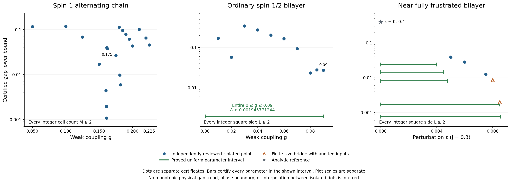
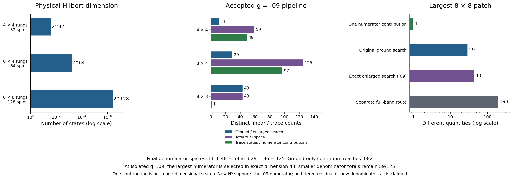
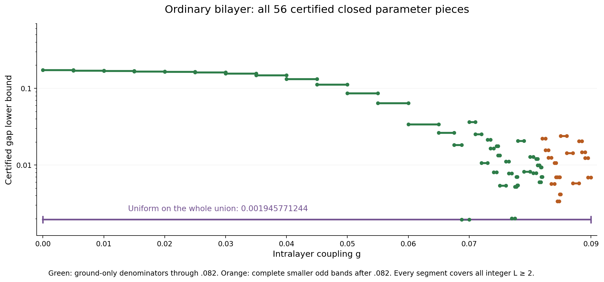
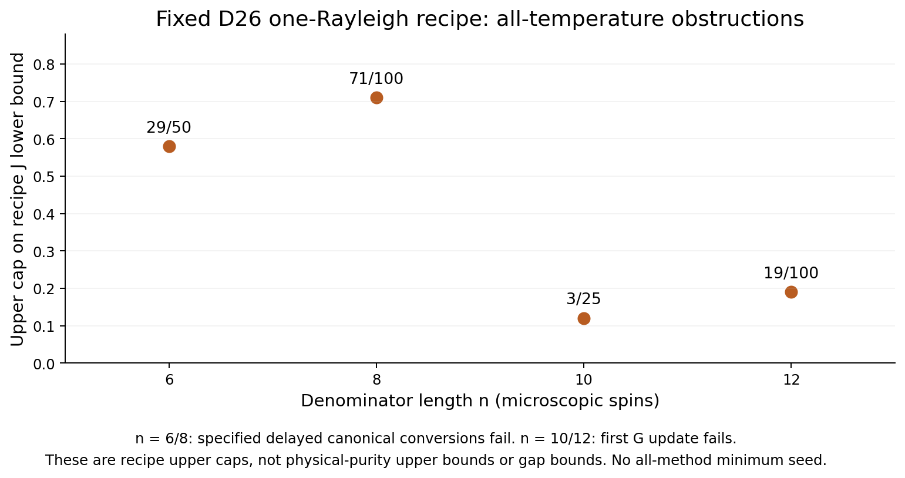
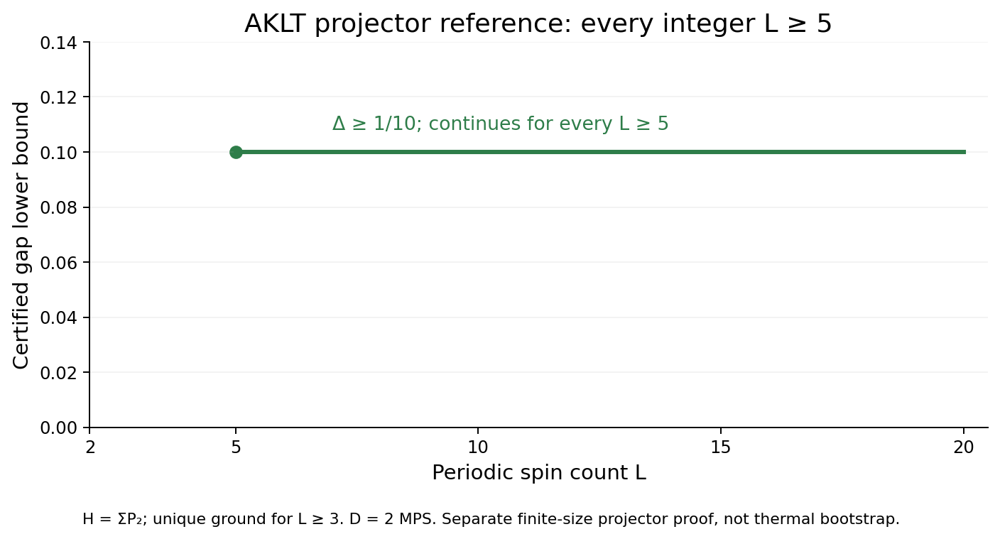
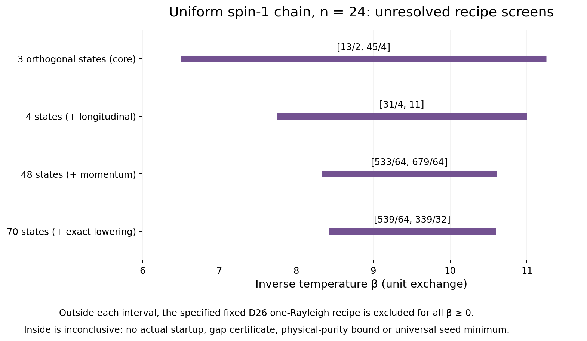

# Certified results and dimension accounting: stage9

Updated 2026-10-10 17:45 EDT (UTC−4) / 21:45 UTC. Exact extraction timestamp is recorded in overview_data.json.

This immutable snapshot extends [stage8](../overview_stage8/README.md), leaving its files unchanged and retaining **all 209 prior positive certificate rows** and their alternatives. Only pinned independently sealed PASS results enter new accepted claims. Source verification and figure extraction do not constitute a fresh spectral-proof audit.

## Strongest accepted results

- **Ordinary square bilayer, every real 0≤g≤0.09, every integer L≥2: gap ≥0.001945771244.** The exact cover has 56 adjacent closed pieces. The isolated g=0.09 certificate is stronger: **0.027330086079**; its two-vector alternative gives **0.001111944974**.
- **Alternating spin-1 chain, isolated g=0.225, every integer M≥2: gap ≥0.045509923956.** No continuous chain interval is inferred.
- **Separate AKLT projector reference, periodic L≥5: gap ≥1/10**, with one D=2 MPS ground state. It is a finite-size projector proof, not a thermal-bootstrap success.
- Uniform-Heisenberg D26 and synchronous mixed-cube results below are **recipe obstructions, not gap bounds or physical-purity upper bounds**. No all-method minimum seed is known from these results.

[Vector PDF](certified_bounds.pdf) · [All 212 exact positive certificate rows](certified_bounds.csv) · [Full provenance/data](overview_data.json) · [All prior method alternatives and history](../overview_stage7/README.md)

## Model and scope conventions

The alternating spin-1 chain has strong exchange one and weak exchange g, with M two-spin cells. The ordinary spin-1/2 square bilayer has rung exchange one and straight intralayer exchange g in both layers/directions, with no crossed exchange. The near-fully-frustrated bilayer is separate: J=0.3, straight J+ε and crossed J. The uniform spin-one Heisenberg chain below instead has unit exchange on every microscopic bond. See [Hamiltonians and normalization](../MODELS_AND_NORMALIZATION.md).

Thermal certificate families use periodic boundaries with positive-direction periodic multiedges retained at size two. Chain results cover integer M≥2; bilayer results cover integer square sides L≥2. Positive bounds certify a unique finite-volume ground state, not infinite-volume uniqueness or arbitrary rectangles. All displayed gap decimals are rounded downward to 12 places; exact fractions and JSON pointers are retained. Bounds are sufficient certificates, not estimated physical gaps, optimal thresholds or phase boundaries. Isolated points need not be monotone and imply no interpolation.

## Third moment and g=0.09

The [independent third-moment review](../third_moment_review/REVIEW.md) verifies full original-trial H³ information, base moment M5, exact enlarged G/A matrices, Gram ranks, and both all-integer scalar certificates. At g=0.09, the enlarged search gives **0.027330086079**, while a separate two-vector numerator gives **0.001111944974**. Both remain in the data.

| Rung patch | Spins | Full Hilbert dimension | Checked enlarged rank | Search used by accepted pipeline | Total used trial dimension | Retained trace/numerator terms |
|---|---:|---:|---:|---:|---:|---:|
| 4×4 | 32 | 2^32 | 16 | 11 ground | 59 = 11+48 | 49 denominator states |
| 8×4 | 64 | 2^64 | 43 | 29 ground | 125 = 29+96 | 97 denominator states |
| 8×8 | 128 | 2^128 | 43 | 43 enlarged | 43 | 1 numerator contribution |

The smaller enlarged 16/43 searches are checked but are not substituted into denominator certificates. Their complete omitted-state bounds remain inherited and unchanged. The largest new 43-dimensional exact search is distinct from the earlier ≤30 filtered span and from a one-state numerator trace. No new filtered-state residual, base M6, denominator lower bound, full many-body diagonalization, or MPS bond dimension follows from these counts.

[Vector PDF](trial_space_counts.pdf) · [Exact dimension records](trial_dimensions.csv)

| Isolated bilayer g | Strongest accepted gap |
|---:|---:|
| 0.01 | 0.168921021674 |
| 0.02 | 0.057308457817 |
| 0.03 | 0.341601445704 |
| 0.04 | 0.272402896810 |
| 0.05 | 0.203655275044 |
| 0.06 | 0.164746706191 |
| 0.07 | 0.093479385120 |
| 0.08 | 0.023243965748 |
| 0.085 | 0.027887084487 |
| 0.09 | 0.027330086079 |

## Continuous interval

The independently sealed [new interval review](../interval_range_009_review/REVIEW.md) adds seven exact adjacent closed pieces on **[0.085,0.09]**, uniformly bounded below by **0.005788366954**. Together with all 49 earlier pieces, the whole **[0,0.09]** has the unchanged bound **0.001945771244**. Each piece uses checked denominator residual/complete-tail inputs and finite-window/short-size certification; it is not interpolation between isolated points. The fixed largest numerator is selected in exact dimension 43; smaller denominator totals are 59/125, retaining 49/97 states.

| Exact lower g | Exact upper g | Uniform gap lower bound |
|---:|---:|---:|
| 17/200 | 43/500 | 0.024024513414 |
| 43/500 | 87/1000 | 0.014301717985 |
| 87/1000 | 11/125 | 0.005788366954 |
| 11/125 | 177/2000 | 0.020470914121 |
| 177/2000 | 89/1000 | 0.014672573603 |
| 89/1000 | 179/2000 | 0.012353003785 |
| 179/2000 | 9/100 | 0.006892292777 |

The original [0,0.07] cover has 16 pieces; [0.07,0.078] adds 15; [0.078,0.08] adds two; [0.08,0.082] adds seven; [0.082,0.085] adds nine. Ground-only denominator coverage reaches g=0.082. After that, smaller complete odd bands supply 49/97 trace states. No largest-patch odd band enters this interval pipeline. The old [0,0.085] proof uses no new H³; new .09 inputs are a separate extension.

[Vector PDF](ordinary_interval_pieces.pdf) · [All exact pieces](ordinary_interval_pieces.csv)

## Uniform spin-one Heisenberg: fixed D26 recipe

The [sealed independent review](../uniform_seed_size_review/REVIEW.md) accepts the [diagnostics](../uniform_seed_size_diagnostics/README.md) at denominator microscopic lengths n=6,8,10,12. The numerator is exactly one Rayleigh contribution from the archived D26 MPS at length 2n. Any valid upper denominator traces, including exact traces, remain subject to these recipe obstructions.

| Denominator n | Full dimension 3^n | Numerator full dimension 3^(2n) | Strict recipe J_lower upper cap | Accepted obstruction |
|---:|---:|---:|---:|---|
| 6 | 729 | 531441 | 29/50 | All legal completed time-first delays then specified canonical conversion |
| 8 | 6561 | 43046721 | 71/100 | Same specified delayed-conversion family |
| 10 | 59049 | 3486784401 | 3/25 | First G update; four orthogonal denominator witnesses |
| 12 | 531441 | 282429536481 | 19/100 | First G update; four orthogonal denominator witnesses |

The bounds hold for all beta≥0. At n6, only delay 0 is legal; at n8, delays 0 and 1 are legal; each converted cycle fails. A two-witness construction already gives J_lower<3/10 at n10/12. These are upper envelopes on attainable **certified lower inputs**, not upper bounds on the true physical purity. D=26, one numerator contribution, four denominator witnesses, and physical dimensions count different things. No exclusion of richer numerators, other MPS, arbitrary adaptive switching, new later-base information or other inequalities is implied. Untested n2/n4 and all-method seed minima are outside scope.

[Vector PDF](recipe_upper_caps.pdf) · [Typed exact upper-envelope rows](recipe_upper_envelopes.csv)

### Excited-MPS witnesses

The [sealed core three-state review](../mps_excited_seed_review/REVIEW.md) independently verifies exact staggered source contractions and excludes the fixed one-Rayleigh D26 recipe for every beta≥0 at denominator lengths **n=14,16,20**. At **n=24**, the unresolved closed-box union is **[13/2,45/4] = [6.5,11.25]**; outside it the specified recipe is excluded. An optimistic upper orbit surviving inside the window does not certify realizable denominator bounds, actual startup or a physical gap. The three denominator witnesses have Sz=0,+1,−1 and are orthogonal fixed trials, not certified eigenvectors or a certified triplet. Ground MPS bond D=26 and single-source bond upper bound 52 are distinct from three linear witnesses and full Hilbert dimensions 3^n / 3^(2n). Exact physical tests through n6, source contractions through n24 and ground contractions through n48 are sealed. This historical three-state screen is retained; the independently sealed extensions below tighten it. [Exact upper-envelope rows](excited_witness_upper_envelopes.csv).

## Small ordinary-bilayer seeds: synchronous mixed-cube obstruction

The [independent acceptance](../joint_small_seed_review/ACCEPTANCE.json) and [proof](../joint_small_seed_review/PROOF.md) cover isolated g=0.04 and 0.05 for seeds 2×2/4×2/4×4 and their coordinate-swapped mirror, for every finite beta≥0 including the unbounded cold ray. All six synchronous complete-cube routes, positive partial outputs, compatible same-base maxima, oriented-square root/product closure, and full-joint retention have no positive repeated-cycle or 499/500 small-defect onset within the defined algorithm.

The review checks 644 records, 5,778 sealed quotient upper comparisons and 520 partial-support patterns. This does not cover fresh trace injections, asynchronous other-base updates, stronger simultaneous optimizers, new inequalities or geometries, all methods, physical gaplessness or a phase boundary. It supplies no new positive gap row. The larger-seed g=.04/.05 positive certificates coexist without contradiction. See [all scoped statuses](unplotted_status.csv); none is plotted as a zero gap.

## Preserved references and alternatives

All 207 counted/joint chain candidate paths, historical fixed-order obstructions, earlier ordinary-bilayer ground/filter/combined alternatives, continuous near-frustrated interval proofs, and the AKLT projector reference remain unchanged in source and retained in the data. The historical stage7 unreviewed-.09 status is annotated as superseded, not silently used as a current rejection. [Chain paths](chain_candidate_routes.csv) · [Combined comparisons](combined_route_comparison.csv) · [Selected failures](combined_selected_failures.csv).

AKLT means H=ΣP₂ with coefficient one. Its periodic uniqueness starts at L=3, the stated gap at L=5; L=2 has four ground states. The convention B+B²/3+2I/3=2P₂ doubles the gap. The current thermal-transfer sufficiency failure is not universal transfer impossibility.

## New independently reviewed chain frontier

The [independent expanded-reference review](../chain_frontier_above_02_review/README.md) certifies three isolated couplings, each for every integer M≥2 with a unique finite-volume ground state:

| g | Gap lower bound | Initial β | Asymptotic onset M |
|---:|---:|---:|---:|
| 0.21 | 0.101607534008 | 8.3 | 64 |
| 0.22 | 0.065580452251 | 8.55 | 128 |
| 0.225 | 0.045509923956 | 8.7 | 256 |

All three uniform bounds are limited by the [8,16] finite window. The 72 saved paths and 378 window checks belong to the independent review; this overview extracts its three accepted summaries. No interval between these points is certified.

| Quantity | M=4 denominator | M=8 numerator |
|---|---:|---:|
| Physical spin count | 8 | 16 |
| Full Hilbert dimension | 3^8 = 6,561 | 3^16 = 43,046,721 |
| Comparison reference | 67 = 1+12+54 | Unchanged input |
| Complement of that reference | 6,494 | Not inferred from 67 |
| Ground trial / numerator search | 1,099 | 2 |
| Trial support | See full ground action 1,107 | 43,294 |
| Retained numerator contribution | Not this quantity | 1 |

The M4 reference counts one vacuum, 12 one-triplet states and 54 two-triplet states; all 20 single quintets lie in its complement. Weak-action union 786 and residual union 719 count configurations, not MPS bonds. The expanded reference67 does not expand the M8 search. The independently accepted g=.25 result is only an all-temperature obstruction for its specified saved recipe, not physical gaplessness or a universal frontier.

## New excited-MPS longitudinal and momentum screens

Both the [longitudinal extension](../mps_excited_seed_review/longitudinal_extension/REVIEW.md) and [momentum/spin-completion extension](../mps_excited_seed_review/momentum_extension/REVIEW.md) are independently SEALED PASS. The four-state longitudinal screen excludes the specified fixed D26 one-Rayleigh recipe at all β≥0 for n=14,16,20. At n24, successive necessary screens leave:

| Orthogonal denominator trials | Unresolved closed β interval |
|---:|---:|
| 3 (historical core) | [13/2,45/4] |
| 4 (longitudinal) | [31/4,11] |
| 48 (momentum) | [533/64,679/64] |
| 70 (exact spin completion) | [539/64,339/32] = [8.421875,10.59375] |

The exact zero global-raising norm together with total Sz=0 proves this finite n24 trial is a singlet; it does not assume an H eigenstate or assert singlet structure at other uncomputed lengths. Exact normalized lowering turns each of 23 positive-norm transverse momentum modes into its longitudinal partner, giving 1+3×23=70 orthogonal states. Individual physical MPS bond dimensions are ≤52; 70 is a linear span dimension. The denominator full Hilbert dimension is 3^24=282429536481; the n48 numerator has 3^48=79766443076872509863361 states and retains one fixed D26 Rayleigh contribution. No full physical expansion is made above n6.

Every β outside the corresponding interval is excluded for the specified recipe. Inside is only an unresolved necessary-condition screen, never certified startup, realizable upper denominator traces, a gap bound, physical-purity upper bound, or an all-method minimum seed.

[Vector PDF](mps_recipe_windows.pdf). These diagnostic figures are separate from the accepted gap plot.

## Ordinary bilayer g=.10: scoped diagnostics only

The [independently sealed diagnostics review](../bilayer_g010_diagnostics_review/REVIEW.md) accepts three exact ground-lower improvements, restricted endpoint-weighted affine-square degree-five moment brackets of width 10^-10, and a fixed 43-dimensional numerator Ritz bracket of width 10^-10. It separately reproduces 23 explicitly conditional floating sensitivity cases. These are not a new g=.1 bootstrap startup or all-size gap proof.

The principal tested bounded-scan bottleneck is the 8×4 denominator ground uncertainty. Closing a hypothetical fraction of its interval can produce proposals, but those altered inputs are conditional and have not been constructed as new certificates. The new valid lower endpoints alone produce no successful scanned proposal. The moment bracket covers only the stated endpoint-weighted fixed family; it is not unrestricted M0…M5 optimality. The 43D Ritz floor is a compressed-space bound, not a physical ground lower. No new M6 or enlarged-state complete residual is supplied.

The accepted ordinary-bilayer gap range remains the entire [0,.09] with all 56 exact closed pieces and all 209 stage8 gap rows preserved. Physical 4×4/8×4/8×8 rung patches remain 32/64/128 spins with full dimensions 2^32/2^64/2^128; these differ from denominator states49/97 and the one retained numerator.

## Pending and excluded ongoing branches

The chain rank195 independent review was unsealed at this extraction and is pending, without scientific promotion. The ongoing complete bilayer residual and MPS current-operator branches are excluded. The local hardcore-pair commutator is only a proposed exact construction awaiting full residual review; it supplies no accepted gap extension. None of these statuses is plotted as a zero gap.

## Verification and reproduction

Run `bash REPRODUCE.sh`. It verifies all source hashes and pinned review manifests, the exact gap and upper-envelope pointers, all preserved alternatives, dimensions, closed-cover adjacency, and uniform minimum; it runs corruption rejection tests and rerenders all twelve PNG/PDF files byte-for-byte in a temporary directory. It does not repeat expensive physical proof audits. The manifest covers scripts, data, documents, figures and QA. One CPU, 1 GiB address-space cap, BLAS/OpenMP one thread. No root documents, GitHub state or prior sealed files were edited.
